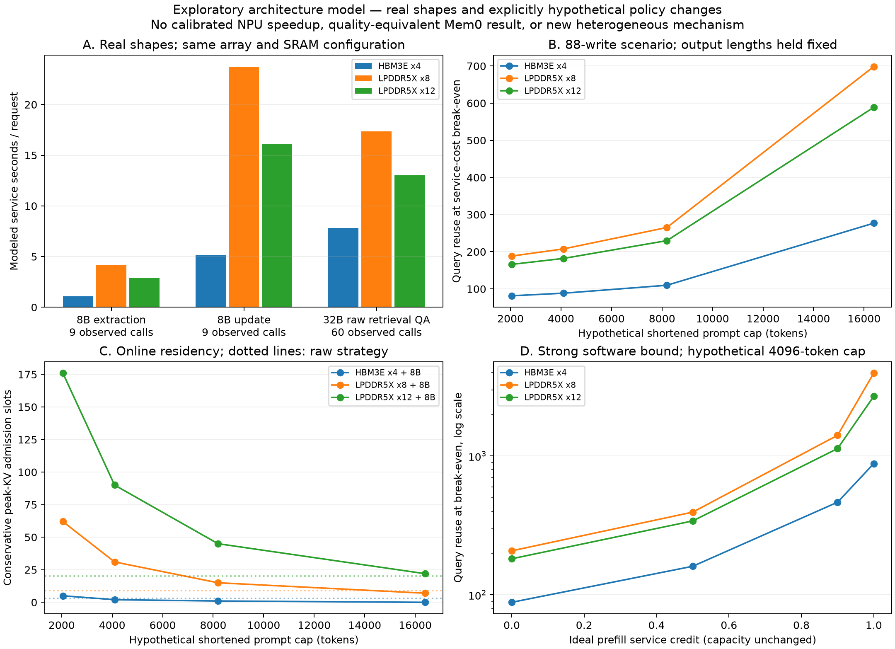

# 第一次架构对照：记忆表示如何改变算存需求

已从协议修复切换到**真实请求 → 张量/数据流模型 → 物理约束下的小规模比较**。这轮交付包含可运行模型、32 个候选配置、160 个目标/场景结果及反事实控制。没有等待完整 Mem0 成功，也没有把失败前缀当成完整应用。

本轮最清楚的发现是：**构建费用的回收点依赖硬件；但当前出现的较大联合选择差异主要由容量可行域解释，而且对 workspace 假设敏感。** 这支持继续研究记忆表示与算存配置的关系，尚不支持提出专用异构引擎。

相对 `455bf8e`，已修复 EmbedRAG `index_finalize` 构建费用被错误键名默认为零的问题。所有 Embedding 阶段现在逐项对账、各有一个账本去向；缺失或未知阶段报错。重算差异见 [修正回执](evidence/architecture/ledger_correction.json)，原版本可由 Git 追溯。

后续 [阵列瓶颈诊断](ARRAY_DIAGNOSIS.md) 保持 baseline 数值不变，拆开低 M padding 与填排空。当前 update 的限制是所选映射的阵列周期；增加带宽无收益，理想阵列上界也仅约 1.38×，不能以低有效利用率的倒数推算加速。

[有限历史配对](FINITE_PREFIX_RESULTS.md) 已补 7 对实际输入/输出及 A800 驻留数据，替代“只有假设长度”的证据空白；其历史范围与下面的 88-write 情景不同，未混接成完整生命周期结果。词面答案指标有差异，尚未证明质量等价。



## 证据层次与输入

- **真实请求形状**：8B 抽取 9 次、更新 9 次，来自失败运行中通过结构检查的前缀；32B EmbedRAG/BM25 各 60 次问答。共 138 个 LLM 请求，模型配置与原始 trace 哈希沿用冻结证据。
- **真实 embedding 形状**：149 个原生调用、151 个实际内核 batch；保留 padding 和逐序列长度，无文本、向量或答案进入公开仓库。见 [导出记录](evidence/architecture/embedding_shapes.json)。
- **模型结果**：有限阵列、分块和内存服务的估计；不是 A800 实测 latency，也不是已校准的新 NPU 预测。
- **策略反事实**：将上述 60 个问答输入长度上限设为 2048/4096/8192/16384，保持其原输出长度。没有声称这些长度由合法 Mem0 状态产生或质量等价。88 次构建是对前 9 次写入形状分布的情景缩放，**不是实测完整构建**。

严格配对的完整应用入口 `capacity_tradeoff.py` 保留。探索模型独立于它；没有削弱应用验收条件。

## 模型与预算

[模型](architecture/model.py)、[配置与来源](architecture/spec.json)、[运行器](architecture/explore.py) 不读取 API 耗时来预测硬件速度。

1. 从 Qwen 配置生成 Q/K/V/O、gate/up/down 和 LM head 的 GEMM。首 token 由 prefill 产生，仅余 O−1 次 decode。
2. 对输出驻留和权重驻留数据流搜索有限 tile；双缓冲 A/B、FP32 累加 C 必须装入本地 SRAM。计算阵列填充/排空、边缘 padding 与末轮阵列利用率均计入。
3. 对 causal attention 分块，显式计 GQA 的 KV 复用；不物化完整 attention score。Decode attention 用中间上下文近似，单独限制其计数误差。
4. 每个算子以 compute、DRAM、SRAM 三者的最大服务时间估计可重叠下界，再按依赖串行相加。DRAM 采用 32 outstanding bulk transfers 的控制情景；不模拟 bank/row-buffer。
5. 权重使用 safetensors 的实际字节数；KV 从配置计算。Online 模式计额外 8B 权重、构建 KV 和独立 workspace；offline 模式在构建后卸载 8B。额外冷加载及 P/D 的复制/传输另计。

主要预算为 **850 个归一化系统成本单位**，附加 **450 mm² 面积估计、500 W 功率包络、每设备 50 mm 内存接口**限制。不是美元成本、制造面积或实测 TDP。不同内存允许容量、带宽不同；等可用容量仅作为机制消融。

HBM3E/LPDDR5X 的容量、带宽、能量和接口参数来自 [MemExplorer v2 Table II](https://arxiv.org/html/2604.16007v2#S1.T2)。MAC 能量以本地 H²-LLM §7.1 的 0.682 pJ/MAC 为量级锚点；其工艺实现没有被移植到本模型。逻辑面积、归一化内存价格、SRAM 端口、利用率和链路是公开的未校准假设，独立扫描 0.5×/2×。因此本轮是**带物理参数约束的条件性探索**，不是物理实现优胜证明。

## 实验一：不同角色未自动选出不同硬件

在当前 32 点搜索空间中，三类调用的最小模型服务时间均选中同一配置：

- `mem0_extract_prefix`：`HBM3E4_a16_128x128_s128`，平均 1.085 模型服务秒。
- `mem0_update_prefix`：`HBM3E4_a16_128x128_s128`，平均 5.108 模型服务秒。
- `embed_full_01_query`：`HBM3E4_a16_128x128_s128`，平均 7.774 模型服务秒。

不能从角色名称推出 compute engine / memory engine 的分工。修改 MAC 能量系数到 2× 会改变可行集合，并使更新和问答选择不同配置；该变化是参数敏感性，不是已验证的工艺优势。

同成本上限内还枚举了每类调用 40 个可行 P/D 设备对，计两份权重、完整 prompt KV 传输与等待设备静态能量。它们在本轮单请求串行服务口径下没有优于最佳统一配置。**这不是否定 Splitwise 的并发吞吐优势**：本轮没有到达队列或跨请求 pipeline。另给出不受预算约束的阶段最优 oracle，避免把简化 P/D 当论文复现。

搜索空间还有限：最便宜 HBM 设备为 608.768 成本单位，最便宜 LPDDR 设备为 277.568，两者相加 886.336 已超过 850。因此当前可行 P/D 对均为 LPDDR，尚未检验充分缩放执行域的算力侧＋高带宽侧组合。HBM3E 也不等于 Hybrid-Bonded DRAM-on-Logic：本模型没有小容量 HB 域、大容量 DRAM 域及两者之间的放置/搬运/局部计算路径，不能据此排除 HB-on-Logic 架构。

## 实验二：回收点与容量是两条不同边界

下表固定 16 个 128×128 阵列、32 MiB SRAM；时间列是模型估计。N* 使用 88-write 受控情景、4096-token 假设上限、固定原输出长度，未验证语义质量。

| 内存 | 容量 GB | 成本单位 | 抽取 s | 更新 s | 原文问答 s | 服务量回收 N* | 原文/语义峰值 KV 槽位 |
|---|---:|---:|---:|---:|---:|---:|---:|
| HBM3E x4 | 96 | 641.5 | 1.09 | 5.11 | 7.84 | 88.1 | 3 / 2 |
| LPDDR5X x8 | 128 | 310.3 | 4.13 | 23.69 | 17.34 | 207.2 | 9 / 31 |
| LPDDR5X x12 | 192 | 366.7 | 2.86 | 16.08 | 13.00 | 181.6 | 20 / 90 |

**N 决定生命周期服务量能否回收；active 决定活跃容量能否容纳。** 本轮 active 只是同时保留独立峰值 KV 的 admission 条件，不是实测 batch 或吞吐。所有主结果请求按 B=1 建模。

长度相同的控制不会产生查询节省；额外常驻模型只会占空间。4096-token 假设在 HBM 配置中甚至可能减少槽位，因为还需构建 KV/workspace。不能只比较 15.26 GiB 权重和 KV 差额就认定系统整体容量改善。

在 HBM 参照配置中，给两种策略同样的 0/50%/90%/100% 理想 prefill 时间抵扣后，N* 分别约为 88, 160, 463, 879。此抵扣保留 KV，且比具体 prefix caching 更乐观；它说明可复用输入会显著推迟语义构建的回收点，不能把全部缩短收益记给新硬件。

## 实验三：联合选择有条件差异，但容量解释很强

比较固定 HBM 参照配置选策略再选硬件、固定原文策略选硬件，以及联合选择。查询复用 N=8/32/128/512/2048，活跃状态=1/4/8/16，更新/查询比=0/0.01/0.1。Offline 只取零持续更新。生命周期秒和焦耳独立优化，不混单位，也不冒充端到端 latency。

在 N=8、active=4 的 online 情景中，名义 workspace 令 HBM 原文路径不能满足容量条件，固定硬件时会选择短记忆；联合选择则允许 LPDDR 原文路径避开昂贵构建。**这个差异无需新引擎，普通更大容量即可解释。** 将所有配置暴露的容量限制到同一 96 GB 后，可比较点的联合选择额外收益均为零。

进一步改变未实测 workspace，并给 chunked prefill 一个“不增加时间”的乐观容量控制，检查容量门槛是否人为产生。下列比值是先选策略再选硬件的服务量 / 联合最优服务量：

| 每路径固定 workspace GiB | workspace token chunk | 比值（N=8, active=4） |
|---|---|---:|
| 0.25 | 不切块 | 1.000 |
| 0.25 | 512 | 1.000 |
| 1 | 不切块 | 1.000 |
| 1 | 512 | 1.000 |
| 4 | 不切块 | 6.107 |
| 4 | 512 | 1.000 |
| 8 | 不切块 | 固定策略不可行 |
| 8 | 512 | 固定策略不可行 |

因此，不把最大的比值当论文 speedup。下一项有信息量的实测是**真实有效记忆长度和优化服务下的 workspace/驻留**，而不是继续换 schema。

容量收益本身可以是架构价值。这里的不足在于决定可行边界的 workspace 尚未核实；1× 只反驳大比值的稳健性，不能证明实际 chunked prefill 已消除收益。该控制没有重执行分块 GEMM、attention、权重加载和调度。

## 边界、验证与下一步

后台完成 18 项 A800 BF16 GEMM 微基准：从每类真实请求的中位输入长度取 Q/up/down 三个投影，分别测 prefill M=L 和 decode M=1。矩阵内容为固定种子的合成数据；每个 eager/graph 模式记录 5 组、每组 10 次 CUDA event 时间。没有重跑 Mem0。

| 请求来源 | Prefill GEMM TFLOP/s 范围 | B=1 Decode GEMM TFLOP/s 范围 |
|---|---:|---:|
| `mem0_extract_prefix` | 224.0–232.0 | 1.45–1.59 |
| `mem0_update_prefix` | 192.0–210.5 | 1.45–1.58 |
| `embed_full_01_query` | 231.7–234.4 | 1.40–1.58 |

数据见 [operator_calibration.json](evidence/architecture/operator_calibration.json)，脚本见 [profile_a800.py](architecture/profile_a800.py)。这些是预热、重复相同权重的矩阵微基准，可能受缓存影响；不包含 attention、完整 decoder 或 CPU schema，不是实测 HBM 流量。它们确认不同 M 形状在现有 GPU 上的执行差异，并提供后续计算模型校准点；**尚未把该测量外推成新 NPU 时延，也未据此校准未合成的面积/能量系数**。


这版不包含 softmax/normalization/vector kernels、实测 DRAM 计数、数据库 CPU 时间、真实并发队列和热模型。采用最快 tile 映射后报告其能量，未单独穷举最低能量数据流。完整质量、同 SLA serving 和 MemExplorer 原生复现均未完成；KEEP/TokenCake 应在具体涉及 KV 复用或工具暂停时加入对应机制。

协议支线已自然结束并释放其服务，历史完整运行仍为失败/无完整 QA；状态冻结见 [回执](evidence/architecture/protocol_branch_status.json)。后续仅恢复其副本做有限前缀配对，没有续开构建协议变体。本轮不以“所有软件均无效”为架构研究前提。

当前可保留的研究问题是：**在质量/服务约束下，语义记忆改变读写工作量和驻留状态，是否改变算存配置的 Pareto 边界？** 现有条件模型已经可算这一问题；尚未发现超出普通容量配置的新硬件机制。

复现（标准库模型；绘图需 matplotlib/numpy）：

```bash
python3 architecture_unittest.py
python3 accounting_unittest.py
python3 -m architecture.explore
python3 -m architecture.report
```

单元检查独立覆盖小矩阵计数、首 token、138 个真实请求的 FLOP 对账、合法 tile、GB/GiB、预算、同资源换名无收益、相同长度无虚假节省、卸载驻留和维护抵消回收。它们验证核算逻辑，**不代替硬件时延校准**。输入与模型源码 SHA256 已写入 [机器可读结果](evidence/architecture/exploration.json)。
