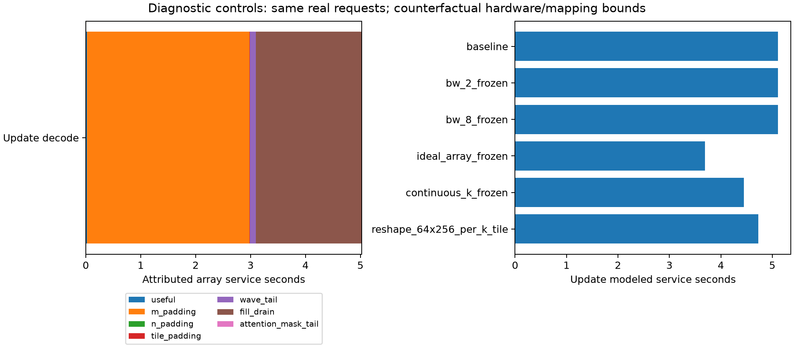

# P1：更新 Decode 的阵列周期来自哪里

固定 `HBM3E4_a16_128x128_s128` 和原有 9 次更新请求。下列是条件模型诊断，**不是 A800 利用率测量或可实现新引擎的收益**。脚本：`python3 -m architecture.diagnose_array`。

更新平均总服务时间 5.107952 s，decode 为 5.023961 s。Decode 的有效 FLOPs / 服务时间为 2.426 TFLOP/s，相对 524.288 TFLOP/s 理论峰值为 0.463%。该比例不能解释为晶体管活动率。

## 周期守恒分解

| 项 | decode 阵列服务秒 | 占阵列周期 |
|---|---:|---:|
| useful | 0.023250 | 0.463% |
| m_padding | 2.958858 | 58.895% |
| n_padding | 0.000000 | 0.000% |
| tile_padding | 0.002446 | 0.049% |
| wave_tail | 0.108364 | 2.157% |
| fill_drain | 1.930995 | 38.436% |
| attention_mask_tail | 0.000048 | 0.001% |

GEMM 的原公式是 `waves × (K + ceil(K/tk) × (R+C−2))`。依次计必要 MAC、M 维 padding、N 维 padding、软件 tile 对齐、最后一波未用阵列、每段 K 的填排空。Attention 另计掩码/尾块无效 MAC，并分别记录 QK/PV 波次。顺序决定 padding 的记账分配；总量严格守恒。分解是机会成本，不是这些 MAC 实际切换或消耗同等能量。

低 M 行闲置占约 59%，填排空占约 38%。**这里的硬限制来自当前映射与周期假设，不能直接推断实际硬件也按此方式排空。** `continuous_k` 允许 GEMM 跨 K tile 连续流动，仅每个输出波次填排空一次；attention 的独立 QK/PV 仍保留填排空。它是替代调度界，不是已经证明可在给定端口实现。

## 带宽、理想周期与重新映射

| 控制 | 更新服务秒 | 相对原映射 |
|---|---:|---:|
| `baseline` | 5.107952 | 1.000× |
| `bw_0.5_frozen` | 7.926805 | 0.644× |
| `bw_0.5_remap` | 7.900493 | 0.647× |
| `bw_2_frozen` | 5.107952 | 1.000× |
| `bw_2_remap` | 5.107952 | 1.000× |
| `bw_4_frozen` | 5.107952 | 1.000× |
| `bw_4_remap` | 5.107952 | 1.000× |
| `bw_8_frozen` | 5.107952 | 1.000× |
| `bw_8_remap` | 5.107952 | 1.000× |
| `ideal_array_frozen` | 3.694806 | 1.382× |
| `ideal_array_remap` | 3.686043 | 1.386× |
| `continuous_k_frozen` | 4.447477 | 1.149× |
| `continuous_k_remap` | 4.441615 | 1.150× |
| `reshape_64x256_per_k_tile` | 4.731742 | 1.080× |
| `reshape_64x256_continuous_k` | 4.595971 | 1.111× |
| `reshape_32x512_per_k_tile` | 5.349959 | 0.955× |
| `reshape_32x512_continuous_k` | 5.149126 | 0.992× |
| `reshape_16x1024_per_k_tile` | 7.051029 | 0.724× |
| `reshape_16x1024_continuous_k` | 6.422172 | 0.795× |

`frozen` 保持每个 GEMM 的原 tile、OS/WS 与流量；`remap` 重新搜索原 tile 集。Attention tile 由 SRAM 决定，在带宽控制中不变。`ideal_array` 仅以有效 MAC / 全部 MAC 替换阵列周期，DRAM/SRAM 服务仍计入。2×–8× 带宽控制不计新增 PHY、功率或成本，因此仅用于瓶颈定位。矩形阵列保持总 MAC、SRAM 和名义端口预算；布线、时钟与真实面积尚未验证，不能加入物理可行方案排名。

最有信息量的结果是：**加带宽无收益；理想阵列也只有约 1.38× 的更新服务加速界**，随后访存成为限制。不能把 0.46% 的倒数当成加速空间。64×256 的模型改善有限，继续变窄反而恶化，说明填排空、列 padding 与 attention 映射共同约束结果。

当前应检验 B=1 投影和 attention 的映射/连续流动能力，而非凭“decode”标签增添 HB 带宽。单请求的低 M 问题也属于一般 LLM decode；尚未证明 Agent Memory 独有的新机制。现有 A800 微基准只能辅助检查量级，不能校准这些未实现阵列的逐周期行为。

## 验证与搜索边界

全部 baseline 标量与 P0 的已提交探索值逐项一致；所有组件满足周期分项之和等于阵列时间，逐算子限制归属之和等于总服务时间。测试另含手算 2×2 阵列样例、冻结映射流量不变及内存服务下界。

P/D 最小混合组合成本 608.768 + 277.568 = 886.336 > 850；可行集合仅含 LPDDR 对。没有 HB-on-Logic 多域模型。本轮阴性结论仅适用于这个受限空间。

机器可读结果：[array_diagnosis.json](evidence/architecture/array_diagnosis.json)。
