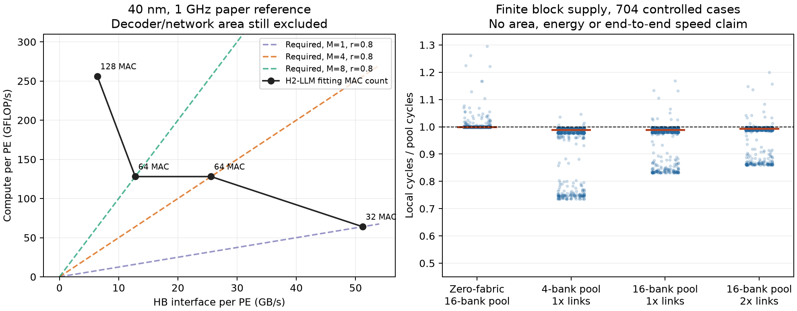

# 异构架构继续分析：接口、MAC 与解码必须一起定尺寸

2026-10-16，承接 `147f636`。本轮重新读取本目录 H²-LLM PDF 第 10 页 §7.1 / Table 6，并以已有 Qwen3 权重做新的 CPU 抽样及有限 FIFO 回放。没有 A800 推理、整模型性能预测或新芯片面积结果。固定 10 GB HB 权重副本候选继续关闭。

**本轮决定：保留矩阵域与近存域共享模型状态的异构研究主线；不再把共享解码池作为主要机制推进。真正需要满足的是接口、MAC、展开端口和合法 M 的联合约束。当前仍未建立超越 H²-LLM 加已有压缩方法的新架构贡献。**

## 1. 上一轮带宽门槛还不是可实现的配置

上一轮允许近存算力和带宽分别取值，适合求必要能力，但不能直接据此选硬件。H²-LLM 的真实物理约束是：同一 PE 的 HB 控制器越宽，留给 FPU 和 SRAM 的面积越少。其 40 nm、1 GHz、6.76 mm²/PE 参考值如下；每 FPU 有 16 个 MAC。

| HB 接口/PE | 控制器面积占比 | 最多 MAC/PE | 峰值 GFLOP/s | 原始 BF16 的 M 交点 | r=0.8 的 M 交点 |
|---|---:|---:|---:|---:|---:|
| 6.4 GB/s | 4.6% | 128 | 256 | 40 | 32 |
| 12.8 GB/s | 10.7% | 64 | 128 | 10 | 8 |
| 25.6 GB/s | 19.7% | 64 | 128 | 5 | 4 |
| 51.2 GB/s | 40.2% | 32 | 64 | 1.25 | 1 |

来源：[H²-LLM 原文 Table 6、§7.1](https://chenzhangsjtu.github.io/files/2025-H2_LLM_ISCA25.pdf)。本地 PDF 的路径、SHA256 与派生数值在 [资源账本](evidence/architecture/supply_resource_bounds.json)。沿用论文工艺，不把其 40 nm 面积与已有中央域的不同工艺面积相加；也不线性缩放到新工艺。这些最大 MAC 数**尚未为新增解码器、共享网络留出经验证的面积**。

推导只用权重一次读取和跨 M 复用：

\[
I_W=\frac{2MKN}{2rKN}=\frac{M}{r},\qquad
M_{balance}=r\frac{2n_{MAC}f}{B_{HB}}.
\]

超过交点，只说明乘加吞吐不足以用满该峰值权重接口，不代表该 PE 不能执行，也不说明它一定慢于中央域。激活、归约、SRAM、bank 时序和解码还会降低有效供数。

例如 M=4、r=0.8、51.2 GB/s 需要 256 GFLOP/s 才能消费全部权重供数，而该参考点只有 64 GFLOP/s。**不能拿最宽接口和另一配置的最多 MAC 拼成一个设备。** r=0.8 是受控条件，非全模型压缩实测。

上一轮 SimpleMem 并发问答、近存份额 10% 的门槛同时要求约 **3.332 TB/s 与 50.351 TFLOP/s**。只按接口宽度计算，66 个最宽端口已有足够总带宽，但关联的 MAC 只有 **4.224 TFLOP/s**；261 个 12.8 GB/s 端口关联 **33.408 TFLOP/s**。这是旧假设与纸面参考点的尺寸核查，**不构成同预算实现，更不能据此预测系统速度**。模型容量、PE 总面积和额外逻辑仍需同时成立。

论文的 8 通道×16 bank×256 MB 容量配置也只是参考，不能直接容纳当前约 61 GiB 的 32B BF16 权重。本轮只借其每 PE 的资源约束，未将其整个系统搬作可运行当前模型的候选。

## 2. 实际合法 M 决定这种取舍是否重要

用已冻结的合法分组记录计算一次读取权重的字节占比；下表取并发问答、维护不限线程的受控场景。不是 CUDA 实测 batch，也不是执行时间占比。

| 满足的 M 范围 | SimpleMem 权重字节占比 | LightMem 权重字节占比 |
|---|---:|---:|
| M≤1 | 29.54% | 96.85% |
| M≤4 | 99.43% | 98.89% |
| M≤8 | 99.43% | 98.99% |
| M≤32 | 99.47% | 99.69% |

因此，以最宽接口为默认近存配置，会在两个真实记录族上遇到不同的算力匹配条件。对 SimpleMem，大量权重消费来自合法合批后的 M=4；LightMem 的这条记录则仍以 M=1 为主。不能为了宽接口删除合批，也不能用后者替代全部工作负载。

这支持**算力—接口联合配置**，并没有证明一个新的分区机制。H²-LLM 已覆盖硬件/数据流协同；我们的下一项机制必须对照其数据归属和算子分裂，而不是重新发现 Op/B 匹配。



## 3. 真实连续块是否支持共享解码池？

在 moe-server 已有 BF16 checkpoint 上重新取样，没有下载或输出权重。沿用上一轮每模型 22 个矩阵及其训练所得指数窗口；每矩阵按 N 维划分 16 个输出所有者，每个取 32 个连续的 256 权重块。新窗口避开旧的全部 12 个训练/测试窗口，始终留在自己的 N 分片内。只导出大小、转义数、位置和哈希。

| 检查项 | Qwen3-8B | Qwen3-32B |
|---|---:|---:|
| 检查权重数 | 2,883,584 | 2,883,584 |
| 检查块数 | 11,264 | 11,264 |
| 384 字节块 | 11,209 | 11,249 |
| 448 字节块 | 55 | 15 |
| 含索引存储/原始字节 | 0.76648 | 0.76604 |
| 位模式重构 | 全部通过 | 全部通过 |

这是位置确定的有限样本，其比值是样本字节直接相除；与上一轮矩阵大小加权统计口径不同，不把差异解释成 codec 改进。参考 codec 仍为 TCA-TBE 启发实现，不是 ZipServ 精确复现。实际 DRAM row/bank 地址还没有采集；这里的 bank 是保留 N 数据归属的逻辑供数组。

块尺寸总体均匀，但转义处理成本未必相同。例如 8B 中间层 q_proj 的某个分片有 872 次转义，其他分片为 177–441。仅按 384 字节块占比就否定解码不均衡也不准确。

### 有限流水模型的边界

- 每个组固定权重归属；一共 16 个解码器。比较固定本地、免网络代价的全共享，以及 4/16 bank 分组的收费数据路径。
- 每 bank 两个压缩输入信用、两个展开输出信用；信用分别保持到解码结束、所有者消费结束。计算按原块顺序消费，重排等待占用输出容量。所有方案拥有同样的合法 M 复用，不重复解码同一个块来制造成本。
- 解码器每周期最多 16 个权重、32 字节输入，转义默认 1 个/周期。周期取这些服务量的最大值；它是能力条件，**不是 RTL 测量**。
- 共享网络分别传递压缩输入与展开输出，两个方向均收费。总链路宽度扫描 256/512/1024 B/cycle/方向，2 周期流水传播延迟；传播不重复占用包的串行传输时间。局部共享与全共享没有免费额外 decoder。
- 每次跨网络传输另带 8 字节所有者/序号描述。输入槽按 codec 最坏的 576 字节原始回退加描述预留，不按本次多数 384 字节块缩小硬件；两级权重 FIFO 合计 35,328 字节，各组织相同。
- 计入每块 8 字节偏移和表头/对齐的一次 bank 服务。未模拟目录 cache、row 激活、bank 模式切换、实际 NoC 拓扑、激活/部分和、功耗和面积。输出 buffer 只覆盖权重，不是完整 PE SRAM。

硬件参数取 Table 6 的四对接口/MAC 条件，M 扫描 1/4/8/29，共 **44×4×4=704 个有限供数条件**。这是控制矩阵，四种 M 不是实际频率分布，不能对点加速求平均后宣称完整工作负载受益。

| 组织 | 中位数：本地周期/共享周期 | 最好单点 | 超过 1% 的点数 | 超过 5% 的点数 |
|---|---:|---:|---:|---:|
| 全共享、免网络代价 | 1.0000 | 1.2953 | 41/704 | 16/704 |
| 4 bank 共享、1× 链路 | 0.9884 | 1.0458 | 3/704 | 0/704 |
| 16 bank 共享、1× 链路 | 0.9895 | 1.1688 | 11/704 | 6/704 |
| 16 bank 共享、2× 链路 | 0.9937 | 1.1994 | 13/704 | 6/704 |

1× 链路总宽 512 B/cycle/方向，对应全部解码器的峰值展开能力。表中网络已付传输周期和 buffer 需求，**尚未付经综合的面积/静态功耗，不能称为同成本比较**。免网络代价版本使用同一确定性仲裁器，不是最优调度器，也不是所有实现的数学加速上界。该版本个别点略慢，反映共享仲裁和有限信用的相互作用。

### 最强正例应当怎样解释？

8B 中间层 q_proj、M=1、51.2 GB/s 条件下，本地为 1023.734 周期，16 bank / 2× 链路共享为 853.570 周期，即 1.1994×。把本地转义能力从 1 提到 2 个/周期，本地变为 650.734 周期；4 个/周期则为 527.734 周期。其他五个超过 5% 的点同样附有这一控制。

**这说明最强正例首先暴露的是默认单路转义服务能力，尚未证明需要跨 bank 的新共享网络。** 增加本地转义通路同样要付逻辑面积；本轮没有两种逻辑的 PPA，不能进一步断言它便宜多少。但无需先发明大网络，就存在更直接、必须比较的局部能力调整。

Huff-LLM 已给出列共享解码、在消费端保持压缩的组织；ZipServ 已区分小批量融合解码和大 prefill 的解压后 GEMM 路径。因此“推迟解压”“共享解码”“按 M 选路径”本身均不是贡献。[Huff-LLM §3.2](https://arxiv.org/html/2502.00922v1)、[ZipServ §4–5](https://arxiv.org/html/2603.17435v1)。此处没有宣称复现它们的 decoder。

## 4. 当前应作出的取舍

1. **共享解码池不作为下一项主架构机制推进。** 真实样本有少量正例，但覆盖窄，主要受具体转义配置影响；更多物理开销尚未计入。保留样本、有限模型、正反控制，不再扩大样本或网络参数寻找一个漂亮峰值。这不是证明所有共享解码都无效。
2. **异构主线仍是矩阵域与近存域共同访问模型状态。** 现在可以明确排除“独立加总峰值算力/带宽”的资源设定，要求每个供数组同时满足 MAC、接口、展开端口和容量约束。常规压缩是共同基线。
3. **尚未敲定具有新颖性的下一项物理机制。** 当前证据不足以把 H²-LLM 式双域加压缩重新命名为新方案。后续若提出不同的数据归属、bank 组织或跨域数据路径，必须解释它具体减少哪种移动/阻塞，并与原方法在同一资源约束下比较；本轮不据此再开启大规模 DSE。

这次的有效进展是把硬件可行性收紧到了实际接口/MAC约束，并对共享解码子候选作出取舍。没有新的 Agent 端到端加速、能量或质量结论。

## 5. 复查与复现

- [采样器](architecture/collect_supply_blocks.py)、[连续块元数据](evidence/architecture/supply_blocks.json)：远端 `outputs/bank_supply_02/public_blocks.json`；01 因独立 staging 下 codec 路径定位失败，保留失败日志，未产出有效结果。02 改为读取实际导入模块路径，未更换权重或编码算法。
- [有限信用模型](architecture/bank_supply.py)、[全部条件结果](evidence/architecture/bank_supply.json.gz)、[简要结果及转义控制](evidence/architecture/bank_supply_summary.json)。来源 SHA256 随结果保存。
- [资源推导](architecture/supply_resource_bounds.py)、[资源账本](evidence/architecture/supply_resource_bounds.json)、[绘图](architecture/plot_bank_supply.py)。
- 新增测试覆盖独立单 bank 递推、均匀控制、合成不均衡正控制、输入/输出背压、块和字节守恒、M 复用、接口算力交点，以及流水链路延迟。没有将程序测试等同于物理校准。
- 9 项新增测试、4 项 codec 检查、7 项前轮异构检查通过；[独立证据审计](architecture/validate_supply_evidence.py) 对账 22,528 个样本块及 5,632 个流水账本，并检查新旧采样窗口不相交、N 所有权和来源哈希。[回执](evidence/architecture/bank_supply_validation.json)。

```bash
python3 bank_supply_unittest.py
python3 weight_codec_unittest.py
python3 hetero_boundary_unittest.py
python3 architecture/supply_resource_bounds.py
python3 architecture/bank_supply.py
python3 architecture/validate_supply_evidence.py
python3 architecture/plot_bank_supply.py
```
