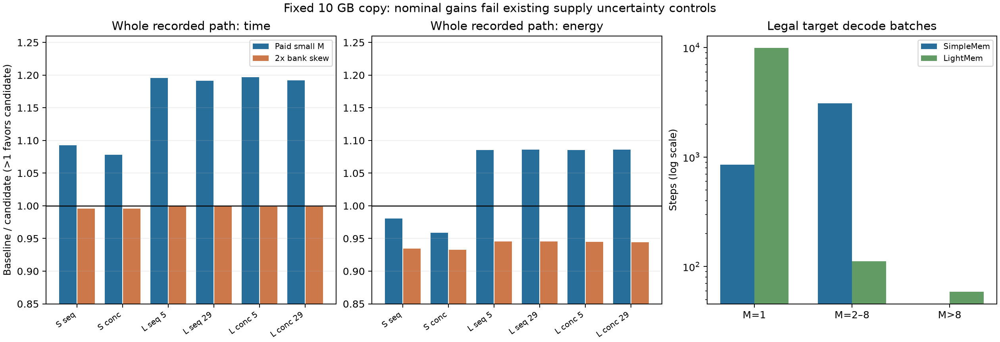

# 小批量供数候选：闭环判定

**决定：结束当前固定 10 GB HB 权重副本候选作为主方案的推进，冻结为负面对照。** 支持 M=2–8 后确实恢复了部分收益，但完整已记录路径的优势对既有 bank/interface 不确定性不稳健。不继续通过低 M 特例、新算法、更大 HB、更多 K 分片或热管理延长这个候选。共同工作负载与核算模型保留。

本轮只重放 a8bf9c1 已有 SimpleMem/LightMem 数值记录；没有新增 A800 实验。下述时间和焦耳全部是条件目标模型结果，不是实测新芯片性能，也不代表完整 Agent 任务质量已验证。

## 一、同一物理组织扩展到 M=1–8

固定 K=2、MAC 数、HB 容量、bank、接口与旧放置比例。两个 K 分区分别形成 M×N 部分结果，再用原归约通道逐行合并。每块权重只从 DRAM 读取一次并服务 M 行；X 分发、权重行间转发、部分和和 SRAM 服务均计费。M>8 合法请求保持大 batch，通过原映射回退，不拆成 8 来帮助候选。

128×128 阵列分成两个 64×128 区域；一块 tile 的输入/权重双缓冲与部分和须同时放入既有 SRAM。部分和占 `2×4×2×M×128` 字节/阵列；HB 权重 tile 必须能放入局部 FIFO 的一半，另半用于双缓冲。归约只有原有 lanes，M 行依次占用；没有免费增加端口或归约宽度。

强统一基线同样获得 M=1–8 映射。两边各增加 32 个行控制器、0.064 mm²，频率乘 1/1.005；控制器 0.32 W 加面积漏电按整个运行期保守计入。上述控制成本是显式未校准假设。独立数值检查覆盖 M=1/2/4/8、非整除 K/N，与 FP64 矩阵乘比较；这验证运算关系，不等于 RTL/PPA。

| 设计 | 成本单位 | 逻辑面积 mm² | 峰值功率包络 W | 预算 |
|---|---:|---:|---:|---|
| baseline | 739.374 | 339.374 | 362.681 | 满足 |
| old_m1 | 833.378 | 333.378 | 387.147 | 满足 |
| small_m | 833.442 | 333.442 | 387.473 | 满足 |
| controller_area2x | 920.403 | 420.403 | 396.169 | 排除：成本超 850 |

共同上限为 850 cost units、450 mm²、500 W 和 50 mm shoreline；这是同一预算约束内的比较，不是实际花费相同。没有为新候选增加预算，也没有重新选择 HB 价格、容量或权重放置。

## 二、依赖与完整账本

- SimpleMem 四个构建窗口同时就绪，保留真实 4→3→2→1 输出结束边界；每个问题内部的规划/检索/回答链顺序执行。
- LightMem 保留原生逐次 add_memory 的构建 flush；29 个维护决策读同一快照。分别重放原线程池上限 5 和不设人为上限的合法 29 请求控制。
- 三个问题按原 harness 顺序执行；另做三问题在构建完成后同时就绪的受控场景。后继只随目标模型前驱完成而就绪，没有将 A800 API 到达时间冻结为新芯片时间。
- 28/56 次 LLM 调用和 31/261 个 Embedding batch 全部消费一次。主机服务用已记录操作区间减去嵌套神经调用，残余 host 时间作为共同初始控制；不把 API 时间按加速比缩放。
- 三个 checkpoint 全驻留 backing；HB 同时仅保存一个模型的副本。包含共同初始权重加载、模型切换重填、设备空闲功耗和全程 20 W CPU 控制。Embedding 使用 backing，不驱逐已有 HB 副本。

调度器采用已就绪静态 batch，批次中不插入新请求。容量约束可拆批，8 并非调度上限。这是一组可复查的保守阶段 DAG；时间区间仅帮助识别原生阶段及 host 时长，不被解释为唯一可能的最优调度。

| 场景 | 强基线 s | 旧 M=1 s | 小 batch s | 基线/候选时间 | 基线/候选能量 |
|---|---:|---:|---:|---:|---:|
| SimpleMem / 顺序问题 | 63.161 | 60.719 | 57.794 | 1.093× | 0.980× |
| SimpleMem / 并发问题 | 58.400 | 57.975 | 54.157 | 1.078× | 0.959× |
| LightMem / 顺序问题 / 维护上限 5 | 74.785 | 62.899 | 62.535 | 1.196× | 1.085× |
| LightMem / 顺序问题 / 维护不设上限 | 72.892 | 61.219 | 61.182 | 1.191× | 1.086× |
| LightMem / 并发问题 / 维护上限 5 | 74.124 | 62.404 | 61.939 | 1.197× | 1.085× |
| LightMem / 并发问题 / 维护不设上限 | 72.231 | 60.724 | 60.585 | 1.192× | 1.086× |

能量比小于 1 表示候选更耗能。SimpleMem 名义能量增加约 2.0–4.3%；LightMem 名义能量减少约 7.9%。LightMem 新小 batch 映射相对旧 M=1 候选的增量很小，其名义收益主要仍来自原生顺序构建；不将它重新包装成不能合批的目标特例。

SimpleMem 四窗口构建本身（不含其他阶段与 cold fill）：

| 设计 | 服务秒 | 模型能量 J |
|---|---:|---:|
| baseline | 37.752 | 3051.24 |
| old_m1 | 38.003 | 3297.40 |
| small_m | 35.041 | 3315.73 |
| bank_skew2 | 38.072 | 3334.15 |

旧报告的强基线为 37.895 s；本轮强基线同样获得已付费小 M 映射后为 37.752 s。因此不能把候选的映射改进全部算作 HB 独有收益。原独立执行 57.822 s 只是历史工作量对照，不作为新硬件加速分母。

## 三、固定设计的反例与判定

| 控制 | 完整路径时间比范围 | 完整路径能量比范围 | 判定 |
|---|---:|---:|---|
| small_m | 1.0783–1.1967× | 0.9587–1.0859× | 名义结果 |
| bank_skew2 | 0.9959–0.9994× | 0.9327–0.9457× | 既有不确定性控制；不调参 |
| half_interface | 0.9959–0.9994× | 0.9327–0.9457× | 既有不确定性控制；不调参 |
| clock_loss5pct | 1.0530–1.1874× | 0.9461–1.0816× | 既有不确定性控制；不调参 |

bank skew 从 1 变 2，或接口效率从 0.8 变 0.4，都会使新增路径优势消失，并增加完整路径能量。这两个控制受同一供数上限限制，不能当作两份独立实验证据。控制器面积加倍则使成本超预算。

另以强基线完成时刻为共同截止时间：较快设备保持供电直到该时刻，候选没有能量优势。这是明确的 always-on 策略控制，不证明采用 power-gating/DVFS 后也无能量空间；不过名义能量优势本身已在 bank/interface 控制下消失，因此本轮不转向能量叙事来保留当前候选。

**结论是当前候选缺少值得继续物理校准的稳健净收益，不是所有 HB 架构无价值。** 10 GB 均匀副本仅覆盖约 15.3% 的 32B 权重，本轮没有改变这一容量边界。共同执行形状、合法批处理记录和模型可用于以后独立提出的新机制；当前方案到此收尾。



## 四、证据边界与复现

以下限制约束结果解释，并不转化为延长当前候选的任务清单：有限历史/三个问题；LightMem 未覆盖过滤器分支且保留已知旧向量行为；不证明跨算法质量等价；未建模 continuous batching、prefix reuse、精确 NoC/bank 时序或热；保留 midpoint attention 和免费 batch compaction；CPU 为共同实测时长锚点与功率控制，非新 CPU 预测。物理参数尚未校准，当前模型也不是击败 H²-LLM/MemExplorer 的证明。

自动对账覆盖 36 次重放、7572 个服务账本；检查依赖、节点一次性消费、非重叠设备服务、容量、预算、流量、能量和输入 SHA。
完整数值事件保存在压缩 JSON 中，没有原始历史、prompt、答案或数据库。代码错误及影响见 [CODE_AUDIT.md](CODE_AUDIT.md)。

```bash
python3 -m unittest batch_closure_unittest family_unittest supply_path_unittest mechanism_unittest architecture_unittest accounting_unittest protocol_controls_unittest
python3 -m architecture.batch_closure
python3 -m architecture.report_batch_closure
```

- [摘要与来源哈希](evidence/architecture/batch_closure.json)
- [完整数值事件压缩包](evidence/architecture/batch_closure_traces.json.gz)
- [自动对账回执](evidence/architecture/batch_closure_validation.json)
