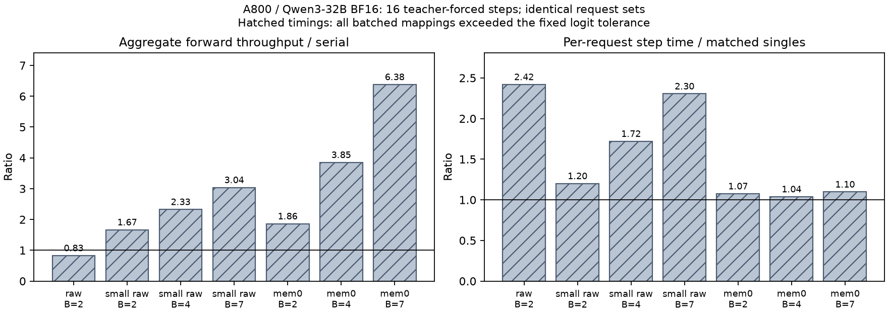
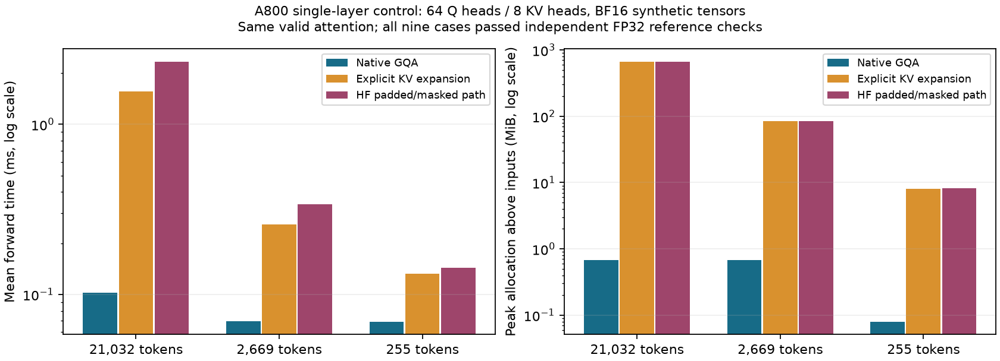

# A800 实测：容量、batch、单请求时间与 attention 软件路径

2026-10-17。本轮按 [预先固定的协议](CAPACITY_BATCH_PROTOCOL.md) 实际运行，继承 [第一性原理分析](CAUSAL_RESOURCE_ANALYSIS.md)，没有选择或恢复任何已关闭的 HB 候选。

**完成 31 个完整模型执行对照、9 个单层 attention 控制，以及 9 个真实前缀容量核算。最可靠的新结论是：容量减少确实发生；当前 HF 软件路径会额外放大长上下文成本；batch 的总吞吐与逐请求时间必须分开。完整模型数值检查未全部通过，不能将本轮时间比值作为等价映射或新硬件加速结果。**

## 1. 实际执行与证据状态

单张 A800 80GB PCIe，Qwen3-32B BF16，revision `9216db5781bf21249d130ec9da846c4624c16137`，PyTorch 2.8.0+cu128、Transformers 4.57.6、HF eager SDPA。原始七个问题与三种输入来自先前冻结的实际记录，源文件 SHA256 和重编码长度全部核对；没有新构建 Mem0，也没有下载模型。

每种表示的单请求与 batch=2/4/7 都左填充到该表示的最大长度；批量使用不同问题，显式假设它们已经独立就绪。每项先做 512-token chunked prefill，再 teacher-force 已记录的 16 个输出 token。另有首条问题的整段 prefill 控制。时间是同步 CUDA event 的 forward 时间，包含当前软件提交方式；不是原生服务 TPS、到达/排队实验或完整 Agent 任务时延。

| 状态 | 结果 |
|---|---|
| 第一轮 `capacity_batch_01`，执行代码 `7067286` | 7 条原文单请求参考完成；第一个 batch 的最大 logit 差超限后停止。失败清单与前缀结果保留 |
| 第二轮 `capacity_batch_02`，执行代码 `ec306d2` | 33 项计划中执行完成 31 项；raw B=4/7 容量预检查跳过。原容差不变，超限逐项保留 |
| 结构/容量核对 | 31 项实际 KV tensor 字节均符合 B×(padded L+16)×256 KiB，时间/吞吐与同请求集合对账通过 |
| 完整模型数值检查 | **21/62 通过原定相对 L2≤0.02 且最大差≤0.5；41/62 超限**。最大相对 L2 0.1168、最大差 2.625 |
| 检查位置的 argmax | 62/62 一致，但仅检查 prefill 末端和第 16 步，不能代替完整分布、自由生成或回答质量验证 |
| 单层 attention 控制 | 9/9 通过独立 FP32 grouped-einsum 参考；相对 L2≤0.01、最大差≤0.005 |
| 收尾 | 所有本轮后台进程已结束；回执中无 GPU compute process。原始输入、token 和日志留在远端 |

所有 7 个完整模型合批项目都至少有一个数值超限。因此后文的时间表保留为**执行路径诊断读数**，不宣称它们是已经验证等价的优化。BF16 的形状/内核变化可能带来数值漂移，但单层控制通过也不能证明整模型漂移已经解释完毕；本轮不放宽阈值、不改成“测试全通过”。

## 2. 容量变化：实际 KV 减少，普通小块检索也已经能装入七条

这里计实际 padded cache tensor，包含 teacher-force 输入的 16 步；不与先前 L+O−1 的完整生成口径混用。

| 输入 | 最大输入 token | B=1 实际 KV | B=7 实际 KV | B=7 峰值分配 |
|---|---:|---:|---:|---:|
| 长原文 | 21,359 | 5.219 GiB | 跳过；计划需 36.529 GiB | 未执行 |
| 512-token 小块原文 | 2,672 | 0.656 GiB | 4.594 GiB | 66.224 GiB |
| Mem0 事实 | 263 | 0.068 GiB | 0.477 GiB | 61.819 GiB |

实际权重仍约 61.024 GiB。raw B=4 的权重＋计划 KV 已达 81.898 GiB，B=7 为 97.554 GiB，尚未计工作空间；二者超过本设备容量。没有触发 OOM 来探测，也没有证明 B=2 是 raw 在所有实现下的最大 batch。

**缩短上下文可以解除这组请求的容量限制，但这里并非只有 Mem0 才做得到：小块原文也装得下七条。** 当已就绪工作只有七条时，进一步把 KV 从 4.594 降至 0.477 GiB，不会自动产生第八条工作。额外空间能否节省设备、副本或功耗，需要另外的服务需求与成本模型。

三种表示的回答质量尚未等价；此表确认资源占用变化，不能作为跨策略净效益排名。

## 3. batch 提高总进展，不保证每条请求更快

每一行都将 batch 与**完全相同的请求集合**逐条执行比较；参考时间是这些单请求的算术平均，吞吐由总 token / 总时间计算，不平均各自 TPS。下列全部合批项目未通过全部数值容差，数字仅为诊断读数。

| 输入 / B | 匹配单请求平均步时 | 合批步时 | 聚合 forward TPS：逐条 → 合批 | TPS 比值 |
|---|---:|---:|---:|---:|
| 长原文 / 2 | 142.40 ms | 344.42 ms | 7.02 → 5.81 | 0.83× |
| 小块原文 / 2 | 78.24 ms | 93.90 ms | 12.78 → 21.30 | 1.67× |
| 小块原文 / 4 | 73.45 ms | 126.35 ms | 13.61 → 31.66 | 2.33× |
| 小块原文 / 7 | 75.49 ms | 173.95 ms | 13.25 → 40.24 | 3.04× |
| Mem0 / 2 | 63.41 ms | 68.14 ms | 15.77 → 29.35 | 1.86× |
| Mem0 / 4 | 65.73 ms | 68.24 ms | 15.21 → 58.62 | 3.85× |
| Mem0 / 7 | 66.75 ms | 73.23 ms | 14.98 → 95.59 | 6.38× |

例如 Mem0 B=7 的总进展约为逐条执行的 6.38 倍，但一轮等待从平均 66.75 ms 增至 73.23 ms。它没有让同一条请求一次前进七个 token。该现象与第一性原理中的“跨请求复用权重”一致，但数值未通过的执行不能升级为已验证服务收益。

raw B=2 的反例尤其不能解释为“合批本来无益”：其单请求中，有一条无 padding mask，另一条有 mask，实际 attention 路径不同。相同 padded 长度不保证相同软件数据流。

## 4. 为什么有的长上下文 decode 是 70 ms，有的是 215 ms

源码核查发现：安装版 Transformers 的 `use_gqa_in_sdpa` 在 CUDA 上要求 mask 为 None 才使用 native GQA；有 mask 时，`repeat_kv` 将 8 个 KV heads 显式展开到 64 个 heads。该展开通过 reshape/clone 实际分配内存。同时，DynamicCache 的 `update` 每步用 `torch.cat` 扩展 K/V。后者在本轮没有单独消融，不能给它凭空分配时间。

为确认前者，用相同有效 Q/K/V、同一随机种子，按实际模型的 64/8 heads、head_dim=128 建立单层控制：无 padding 的 native GQA；无 padding 但显式展开；加上原始 padding mask 的 HF 路径。有效注意力内容相同，FP32 grouped einsum 独立计算参考。每项 2 次预热、16 次计时，另一次 profiler 仅用于核实算子路径，不与主计时时间相加。

| 有效 KV 长度 | Native GQA | 无 mask、显式展开 | 有 padding mask 的 HF 路径 |
|---|---:|---:|---:|
| 21,032 | 0.102 ms | 1.561 ms | 2.336 ms |
| 2,669 | 0.069 ms | 0.258 ms | 0.339 ms |
| 255 | 0.069 ms | 0.132 ms | 0.143 ms |

长上下文 native 路径的输入之上峰值分配约 0.679 MiB，展开/有 mask 路径约 657.4/668.1 MiB。**这些是单层瞬时分配，不是 64 层同时常驻，也不是实测 DRAM 总流量。** profiler 在展开路径观察到 clone/copy；无 mask 为 Flash Attention，有 mask 为 Efficient Attention。

长上下文单层的有 mask 与 native 时间差约 2.233 ms。乘以 64 层约为 142.9 ms，与完整模型 raw 两条参考约 144.5 ms 的步时差接近。这个量级一致性支持主要差异来自软件路径；它不是用单层独立运行替代完整模型 profiling 的严格时间分解，两条实际请求也并不相同。

**因此，不能把这里 215 ms 都解释成权重读取需要，也不能把规避 KV 展开的收益记成新内存硬件贡献。** 同样，不能用这组 eager、左填充、DynamicCache 的读数去预测优化 vLLM/SGLang 或新 NPU 的性能。这是本轮实验排除的一项具体混淆。

## 5. 精确前缀共享：用真实 token 核算，替换过于理想的假设

对七条实际输入建立前缀 trie，只计相同模型、相同位置、完全相同历史前缀可共享的状态；相同后缀处在不同前文之后不共享。另按 16/32-token block 计容量：完整块才能共享，每条尾部不足一块仍单独收费。此核算没有执行 GPU prefix cache，代表潜在容量而非实测命中率。

| 七条实际输入 | 独占 prompt token 总数 | 理想前缀 trie 节点数 | prompt 容量最多可省 |
|---|---:|---:|---:|
| 长原文 | 148,057 | 147,912 | 0.098% |
| 小块原文 | 17,987 | 17,843 | 0.801% |
| Mem0 | 1,678 | 1,522 | 9.297% |

按 32-token 完整块共享，这三组都没有可复用的完整首块。按 16-token 块，长原文只减少 96 个 token slots。**本次原始 prompt 结构中，常规精确前缀共享无法消除长上下文容量负担。** 这不排除改变 prompt 组织、跨检索块部分重算等更强方法；也不能由此声称 KEEP/CacheBlend 没有作用。生成状态与工作空间还须另计。

## 6. 对异构架构主线的实际影响

1. **保留容量这个物理问题。** 短输入确实减少活跃 KV；当前原始长上下文并无巨大可共享前缀。但小块原文已解除七请求的容量压力，不能把这项收益独占归因于语义记忆。
2. **拆开吞吐与单请求时限。** 在给定流式权重路径下，每轮 B 条请求各推进一步；不能把总 TPS 增长理解为同一条请求的权重读取等待被 B 除掉。允许等待、已就绪任务数和每次调用截止时间都需要单独收费。
3. **从流量中剔除可避免的软件膨胀。** 后续物理模型应明确 KV 是否被展开、是否每步复制、读写经过哪层存储。不能把当前 HF 的额外流量当作算法必需，也不能将其优化包装成 HB 的独有优势。
4. **硬件增量尚未成立。** 同样的记忆缩短、合法合批、精确前缀共享和成熟 GQA 都应给统一基线。异构候选必须进一步改善同一有效工作与服务要求下的成本/能量；本轮没有提供这种正面结果，也没有重启 10 GB HB 副本。

本轮完成了实际测量和一个具体的开销归因，没有继续修 Mem0 协议，也没有要求复现所有论文。完整模型的数值漂移仍是采用这些时延作为等价执行证据前的未完成项；若后续需要正式服务收益，应使用适用的成熟服务路径并重新验证，不能靠放宽本轮阈值过关。

## 7. 复查入口

- [完整执行汇总](evidence/architecture/capacity_batch.json)、[相同请求集合的独立对账](evidence/architecture/capacity_batch_analysis.json)。
- [首次失败清单](evidence/architecture/capacity_batch_failed_manifest.json)、[失败前缀](evidence/architecture/capacity_batch_failed_prefix.json)，没有删除不利样本。
- [单层控制、安装版 helper 源码与 profiler 摘要](evidence/architecture/attention_mask_probe.json)、[真实前缀核算](evidence/architecture/prefix_capacity_probe.json)。
- [远端文件 SHA256、进程结束与 GPU 释放回执](evidence/architecture/capacity_batch_receipts.json)。
- CPU 复查：`python3 -m architecture.analyze_capacity_batch`；绘图：`python3 -m architecture.plot_capacity_batch`。理论容量/带宽测试 4 项和已有 accounting 测试 3 项通过；它们不替代上述未通过的 GPU 数值控制。
