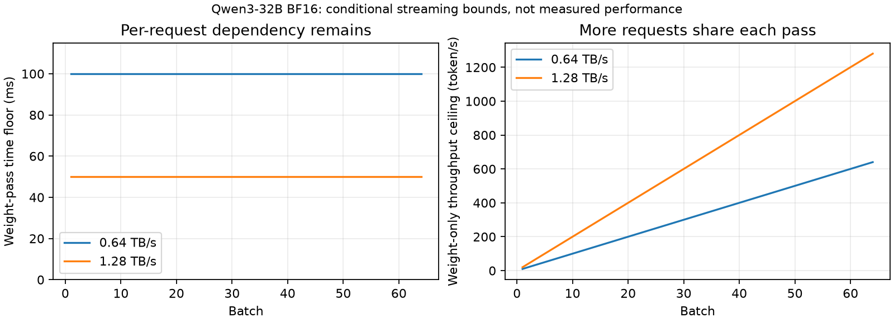

# 记忆怎样改变硬件需求：容量、吞吐与单请求延迟的因果拆分

2026-10-16，基于 `0e68897`。这是进一步的第一性原理分析与 CPU 条件计算，**没有新增 A800 实验，没有选定新的硬件候选**。固定 10 GB HB 副本继续关闭。

后续补充：2026-10-17 已执行 A800 batch/容量、attention 路径与真实前缀控制，见 [实测报告](CAPACITY_BATCH_RESULTS.md)。以下保留初始条件分析；其中理想共享前缀不是后续实测 prompt 的结构。

**本轮最重要的推进：记忆缩短可能通过 KV 容量间接提高权重复用，但提高总吞吐不等于降低每条请求的生成时延。** 这条区别既给出一个值得检验的机会，也限定了“主模型可以改用低带宽存储”的适用条件。

## 1. 先明确最终服务，而非先规定两个硬件角色

真实链条是：事件到达 → 必须执行的处理 → 版本可检索 → 查询/规划 → 最终回答。构建也可能触发旧记忆读取与维护；SimpleMem 的查询中还有 8B 规划调用。因此，“写入=8B、读取=32B”不是一般成立的划分。

至少区分以下约束：事件到可见版本的期限、查询端到端完成期限、持续到达工作量、回答质量，以及某些流式应用的逐 token 时间要求。内部 Agent 调用通常关心完整结果何时可用，不能擅自给它套上人机聊天的逐 token SLO。所有时限在没有部署数据时只能是显式场景参数。

最终比较的量是：在这些条件相同时，每种经过优化的物理配置需要多少设备/副本、容量、功率和成本。统一硬件能够完成任务，不意味着它一定最经济；工作负载复杂，也不意味着分成多个执行域一定更经济。

## 2. Agent Memory 实际可能改变四件不同的事

| 变化 | 直接效果 | 没有自动发生的效果 |
|---|---|---|
| 检索得到更短但足够的信息 | 减少主模型 prefill、活跃 KV、部分 attention 工作 | 主模型权重变小；每次权重读取产生多个连续输出 |
| 提前生成可复用记忆 | 将部分查询工作改为构建/维护；可跨使用摊销 | 后台计算免费；所有未来查询都能受益 |
| 推迟合法维护 | 扩大等待兼容任务、积累 batch 的空间 | 任务立即变得独立；整条写入都可延后 |
| 复用已计算的 KV | 避免部分 prefill | 任意事实能跨位置/前缀/模型直接共享 KV |

质量不足导致的省计算不能算成功转换。另一方面，在同一条真实请求上比较硬件，并不要求先解决不同记忆策略的质量等价。

还必须分开两个“复用”：N 是一份记忆在有效期内被使用的次数，B 是同一轮模型执行中共同消费权重的请求数。一个用户在一个月里逐次提问 1,000 次，可能有很大的 N，却始终 B=1；许多用户各问一次，可能形成大 B，但每份个性化记忆的 N 很小。前者决定构建费用能否摊销，后者影响每输出的权重读取费用。不能用长期查询数证明 decode 会具有高运算强度。

## 3. 一个需要补充到此前判断中的间接路径

“记忆不把 target decode 变成 SD verification”仍然正确。但它**可能通过释放容量，间接改变 target decode 的实际 batch**：

\[
\text{较短的有效上下文}
\rightarrow\text{较小的单请求 KV}
\rightarrow\text{更多可驻留请求}
\rightarrow\text{更大的合法 decode batch}
\rightarrow\text{每个输出分摊更少的权重读取}.
\]

其中每个箭头都有条件。需要独立且已就绪的请求、可接受的排队和执行时间、足够的算力与缓冲，并扣除共享前缀已经节省的容量。孤立地算出“能装几百个请求”不证明存在几百个可一起执行的请求。

设净 KV 空间为 C，单位 token 的 KV 字节为 k，单请求独占状态长度为 l。无共享时：

\[
B_{cap}=\left\lfloor C/(kl)\right\rfloor.
\]

如果存在可精确共享的前缀 s，私有后缀 p，则应按：

\[
C_{KV}(B)=k(s+Bp)
\]

计容量，不能仍按 B 份长前缀收费。共享存储也不自动让所有 attention 读取免费复用。

### 用已有长度做一个显式条件控制

取三种表示各自七个已记录输入长度的最大值，分别作为同形状请求的容量算例，统一设输出为 64 token；沿用首输出由 prefill 产生的口径，KV 长度为 L+63。这不是将七条实际请求同时执行的回放。设**扣除模型、运行时、工作空间后的净 KV 预算**为 16 GiB。它不是一台 16 GiB 设备，也不是当前两张 A800 的实测空闲容量。

| 输入表示 | 最大实际输入长度 | 独立前缀的容量上限 | 只有 8 条就绪请求时的容量/就绪上限 |
|---|---:|---:|---:|
| 原文长块 | 21,359 | 3 | 3 |
| 原文 512-token 切块 | 2,672 | 23 | 8 |
| Mem0 事实 | 263 | 201 | 8 |

**23 与 201 的差别在只有 8 条就绪请求时用不上。** 如果仅有一条请求，三者都只能执行一条；如果原文长前缀确实可共享，其上限也会大幅改变。

额外做一个纯反事实：每种输入除最后 32 token 外都为精确公共前缀、生成状态保持私有，上限分别为 465/662/687；此时 8 条就绪请求全部可装入。没有检查出真实 prompt 具有这种共享结构，不能将这些数值当实测缓存收益。此控制只说明为何必须给基线合法前缀共享。

三个表示的质量未等价；输出 64、净空间 16 GiB、就绪数和共享前缀均为受控变量。这里没有预测并发、吞吐或新硬件收益，也没有将第一个粗粒度检索当最强基线。来源及自动对账见 [capacity_latency_bounds.json](evidence/architecture/capacity_latency_bounds.json)。

## 4. 为什么提高 batch，不等于可以任意降低带宽

先看一个简化的 dense 自回归执行域。每轮 B 条请求各生成一个新 token。假设必须从某条供数路径读取 W 字节线性权重，独占 KV 每条约 k·l 字节，有效带宽为 β：

\[
t_{step}\geq\frac{W+Bkl}{\beta},\qquad
TPS\leq\frac{B\beta}{W+Bkl}.
\]

这个式子只适用于声明的流式数据路径；它省略计算、启动、通信及排队。真实 KV 重用/分层会改变第二项，跨步权重常驻、权重量化或分片会改变 W 和对应路径。它不是一切数据流的统一下界。

当权重项占主导时，**B 增加会让每轮产出更多 token，但每条请求仍需等待本轮权重消费结束**。每输出分摊的字节 W/B 减少；单请求仍有 W/β 的时间下限。实际内核效率也可能随 batch 改变，因此这不是声称实测 TPOT 永远不变。

对当前 Qwen3-32B BF16，按层内线性投影与输出头核算，W=63.967 GB（十进制；不是全部常驻权重容量）。即使先忽略全部 KV 与计算，给定单步时间预算 τ，仍需 β≥W/τ：

| 条件单步预算 | 8B 线性权重带宽下限 | 32B 线性权重带宽下限 |
|---|---:|---:|
| 50 ms | 0.303 TB/s | 1.279 TB/s |
| 100 ms | 0.151 TB/s | 0.640 TB/s |
| 200 ms | 0.076 TB/s | 0.320 TB/s |

50/100/200 ms 都是敏感性条件，未声称是实际 Agent 的 SLO。表中是有效带宽下限，不是接口峰值选型。现有阵列模型还可能受低 M 映射限制；通过下限并不意味着真实设备可行。

图刻意移除 KV、计算与容量约束，不能读成可实现的线性吞吐曲线。它只解释：同一个 batch 在左边没有减少必要权重读取的等待，在右边却产生更多输出。PDF 版本见 [capacity_latency_bounds.pdf](evidence/architecture/capacity_latency_bounds.pdf)。

因此，记忆缩短可能支持**用更少副本满足吞吐**，却未必支持**让每份主模型使用更低带宽**。两种收益必须分开检验。

## 5. 与 HybridSpec 的差别可以说得更精确

常规 batching 的一次权重读取，为 B 条不同请求各推进一个 token。SD verification 的一次 target 权重读取，则可能为**同一条请求**接受多个 token。后者把 target 权重服务费用摊到一条请求的多步进展上；完整收益还受 draft 时间、接受率、验证计算与通信影响。

所以，语义记忆的容量反馈与 SD 的沿序列验证是不同的复用维度。两者可以组合，但那会引入 SD 本身的成本与已有贡献，不能算作记忆机制独有的加速。

本轮重读本地 HybridSpec §VII-F/Fig.19：其 512 GB LPDDR 与 40/80 GB HBM 对照也显示，低到达率时高带宽更有利，增加负载后容量/排队改变排序；同时 HB 已承担许多带宽敏感操作。不能抽掉算法条件，只保留“LPDDR 比 HBM 好”的结论。[论文](https://doi.org/10.1109/ISCA66397.2026.00054)

## 6. “小模型经常用、大模型偶尔用”仍不足以定存储

调用频率决定长期服务量和利用率；**单次必须多快完成**决定瞬时能力。一个很少调用的 32B，若每次都要求很快完成，仍可能需要高带宽与常驻权重。一个频繁调用的 8B，若允许足够等待与合批，其每单位结果的成本可以下降。

但这两种条件也可能同时不成立：8B 查询规划链很急，32B 回答同样很急。SimpleMem 的七次 8B 调用/问题就是必须保留的真实依赖，不能把全部辅助模型工作挪到“后台”。

对内部调用应直接核算：

\[
T_{call}=T_{queue}+T_{prefill}+(O-1)T_{step}+T_{post}.
\]

这里 T_step 表示该调用后续各步的平均时间；完整任务按依赖关键路径，而不是只按某个模型的平均份额。增加 batch 可降低单位结果成本，也会占用等待窗口；若不排队的关键路径已经超过时限，更多并行副本通常只能提高吞吐，不能消除这一条请求本身的依赖。更快的执行、少做必要工作或改变合法执行方式才可能缩短它，但不自动指定某种内存技术。

## 7. 这也解释了部分论文与当前实验为何不同

[MemExplorer v2 §IV-C](https://arxiv.org/html/2604.16007v2) 的 decode throughput 评价采用容量允许的最大 batch，其 DSE 以吞吐/功率为目标。这个目标可以偏好大容量，不能直接拿来回答严格逐请求时限下的选型。当前仓库原模型主要使用有限就绪请求，并非其最大 batch 设置；仓库也还没有生产 SLO 测量。

[Cartridges v1 Appendix A.3](https://arxiv.org/html/2506.06266v1) 的吞吐测量先寻找能装入的最大 batch，预载相应 KV，再生成 128 token。因此，容量缩减到吞吐提升的路径有实际先例；这种峰值评价不等同于低到达率或含重建成本的生命周期收益。

[Niyama v1 §1](https://arxiv.org/html/2503.22562v1) 通过共享基础设施、QoS 和动态 chunking 利用不同请求的等待余量。它提醒我们，物理分离也会失去资源池化收益；不能拿固定的小 batch 统一基线与能够等待的异构候选比较。

这些结论并不否定论文；它们说明了不同评价目标的条件。其它差异——模型精度、算法分支、数据规模及 token 分母——仍按 [PAPER_RECONCILIATION.md](PAPER_RECONCILIATION.md) 与 [LIGHTMEM_PATH_RESULTS.md](LIGHTMEM_PATH_RESULTS.md) 保留。

## 8. 如何从这些条件走向异构研究，而不把软件收益算进去

需要分开两项账：

* **算法收益：**在同一优化统一架构上，合法的记忆策略减少了多少服务量、KV 和必要副本，并增加了多少构建/维护/驻留成本。
* **硬件增量：**固定同一有效记忆策略、精度、工作和服务要求，异构配置相对最佳适用统一配置还能节省多少成本/能量。

令 J 是满足共同质量与服务约束后的成本，不将焦耳、秒、价格直接相加：

\[
\Delta_{alg}=J(U,raw)-J(U,mem),\qquad
\Delta_{arch}=J(U,mem)-J(H,mem).
\]

第一个差要求跨策略质量可比；第二个差可以固定实际请求来探索。还需给普通 P/D、已有近存数据流与共享缓存适用基线同样的算法能力。不能把相同资源拆成两个名字不同的池，就假定获得物理效率优势。

一个可以继续检验、但尚未成立的物理经济性关系是：记忆处理在保证质量和时限时，减少为主模型配置的昂贵容量或副本；专门资源若能更低成本完成这些额外处理，节省可能超过其模型副本、接口、空闲功耗和迁移费用。**统一硬件也必须获得相同记忆收益；真正属于异构的只剩第二项差。** 如果差值不稳健，就保留算法收益，结束该物理候选。

## 9. 当前具体判断

最值得先检验的是以下因果链，而不是再次规定“构建去 HB、主模型去 LPDDR”：

**质量允许的记忆表示 → 同时活跃状态减少 → 在真实就绪度/时限下改变可用 batch 或副本数 → 最经济的算存配比改变。**

已有长度和 KV 数据支持前半段的资源变化，但质量等价和后半段的实际就绪度/成本尚未成立。普通细粒度检索和前缀缓存是这条链的直接反例控制。用现有合法请求继续建模即可，不必先重跑所有论文。

同时保留一个明确的否决关系：如果目标要求的主模型单请求服务速度已迫使其保持高带宽，不能用更多总容量或更大的跨请求 batch 来声称这个约束被消除。可继续寻找副本数、能量或数据移动的真实节省，但不能把吞吐和单请求时延混为一谈。

本轮的进展是把“记忆可能改变硬件需求”落实到容量反馈和时延下限上，**不是证明了新架构获益或新颖性**。测试入口：`python3 -m architecture.capacity_latency_unittest`；核算与图：`python3 -m architecture.capacity_latency_bounds`。
