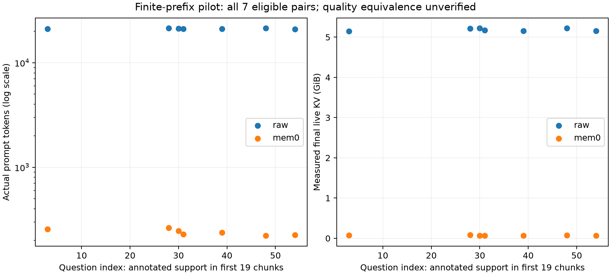

# P2：真实有限历史配对与驻留

已完成 **7 对、14 次真实 Qwen3-32B 问答**。平均输入从原文 21151.0 降到 Mem0 239.7 token；平均输出分别为 84.3 / 49.6 token，均自然 EOS 结束。这里使用真实输出长度，未沿用原文答案长度。

**尚未证明质量等价**：原仓库 substring match 为 4/7 对 2/7。它是词面指标，不是 LongMemEval 官方语义判分；完整 exact/F1/ROUGE 均保存在 JSON。小样本差异也不能证明总体劣势。不能将压缩或服务量下降写成同质量收益，也不能据此给 Mem0 做总体排名。

## 真实状态与问题范围

- 从 `phase4/mem0_8b_guarded` 的前 19 个结构检查通过的片段恢复 114 条事实。这是已有 guarded protocol 产生的状态，**不是原生协议完整成功，也不等于语义正确性已经通过**。
- 失败的第 20 段仍执行一次 ADD；仅在副本中删除这次 ADD，索引中每个 UUID/文本与截止前历史重放逐条相等。一个无时间戳 DELETE 由前后 SQLite 提交行的时间夹定在有效范围。原始文件哈希结束时全部不变。
- 从原来的 60 个问题中预先选择**所有**标注答案支撑 turn 在前 19 段出现的问题，共 7 个；只标准化空白，不按答案结果筛选。未标注的其他 turn 可能在范围外，因此这是按标注支撑定义的有限范围，而非完整数据集。
- 原文侧对同一 19 段构建 FAISS、top-5；Mem0 对恢复的 Qdrant 状态 top-10。沿用 Qwen3-Embedding-0.6B 和原生 query instruction。
- 两侧共同使用受控回答 prompt、数据集 question date、BF16 Qwen3-32B、禁用 thinking、greedy、最多 256 token。这是检索表示的配对控制，不冒充未经修改的端到端原生 QA。

| 问题序号 | 原文输入 / 输出 | Mem0 输入 / 输出 | 原文 / Mem0 最终 KV GiB | 词面匹配 原文 / Mem0 |
|---|---:|---:|---:|---:|
| 3 | 21032 / 59 | 255 / 56 | 5.149 / 0.076 | 1 / 1 |
| 28 | 21359 / 17 | 263 / 76 | 5.219 / 0.083 | 1 / 1 |
| 30 | 21225 / 154 | 247 / 34 | 5.219 / 0.068 | 1 / 0 |
| 31 | 21145 / 38 | 229 / 43 | 5.171 / 0.066 | 0 / 0 |
| 39 | 21065 / 46 | 238 / 37 | 5.154 / 0.067 | 1 / 0 |
| 48 | 21346 / 39 | 221 / 70 | 5.221 / 0.071 | 0 / 0 |
| 54 | 20885 / 237 | 225 / 31 | 5.156 / 0.062 | 0 / 0 |

## 同时驻留与瞬时峰值

GPU 1 上 HF eager + SDPA 串行执行；GPU 0 仅做 embedding。32B 权重实际唯一 storage 为 61.024 GiB，查询时 **8B 未驻留**。没有把两卡构造成新异构系统。

每次 forward 后同步 CUDA，记录同一采样点的权重 storage、实际 cache tensor storage、其他存活 PyTorch 分配、allocator reserved/slack 和 NVML 进程占用。最后 KV 严格等于 `(input + output − 1) × 262144` bytes。初始 prefill 已产生首 token，最后输出尚未再次进入 cache。

| 策略 | prefill 后 allocated GiB | 单次 forward 内 allocated 峰值 GiB | prefill 后 reserved GiB | NVML 减 reserved GiB |
|---|---:|---:|---:|---:|
| raw | 66.133–66.250 | 69.928–70.130 | 71.338–71.578 | 0.494–0.496 |
| mem0 | 61.087–61.097 | 61.127–61.144 | 61.156–61.199 | 0.496–0.496 |

`allocated = weights + actual KV + other_live` 在同一采样点核对；other_live 包含模型 buffer、输入、logits 及其余活跃张量。reserved−allocated 是分配器保留空间，不能算活跃 KV。NVML 差值包含 CUDA/库和分配器外内存，采样粒度也可能产生偏差，不能精确归因于某个 runtime 模块。

峰值使用每次 forward 的 `max_memory_allocated`，**没有把各项独立峰值相加**。但内部峰值时刻的 KV/临时张量未逐算子采样，因此不能用“峰值减最后 KV”声称测出精确 workspace。这里没有 CUDA Graph、vLLM KV 预分配、chunked prefill 或多请求调度；同步采样时间也不是优化 serving SLA。新 NPU 的 workspace 仍应由其 buffer/数据流推导，不能直接用这些 HF 数值替换一个统一 4 GiB 常数。

## 重新检验容量与计算边界

实际平均每对查询节省 5.114 GiB 最终 KV。只计算额外 8B 权重与此项 KV，代数交点为 2.983 个平均活跃请求，取整 3 个。**这是容量情景，不是测出的并发数**：仍需计构建 KV、workspace、状态时序及质量；本次离线查询根本不需常驻 8B。查询复用次数与同时活跃数仍分开。

将每个真实输入和输出送入现有条件模型，得到：

| 配置 | 表示 | Prefill 模型服务秒 | Decode 模型服务秒 | 总模型服务秒 |
|---|---|---:|---:|---:|
| `HBM3E4_a16_128x128_s128` | raw | 6.508 | 4.863 | 11.371 |
| `HBM3E4_a16_128x128_s128` | mem0 | 0.050 | 1.285 | 1.335 |
| `LPDDR5X8_a16_128x128_s128` | raw | 10.629 | 13.549 | 24.178 |
| `LPDDR5X8_a16_128x128_s128` | mem0 | 0.152 | 6.350 | 6.503 |
| `LPDDR5X12_a16_128x128_s128` | raw | 9.970 | 9.933 | 19.903 |
| `LPDDR5X12_a16_128x128_s128` | mem0 | 0.102 | 4.242 | 4.343 |

这批真实短输入可以检验“语义记忆改变主模型的执行形状”，但所有时间仍是未校准 NPU 模型，且当前映射对 B=1 有 [已解释的阵列效率限制](ARRAY_DIAGNOSIS.md)。完整生命周期回收点没有拿这 7 个问题与原先 88 次构建情景直接拼接。

在 HBM 参照配置中，原文 prefill 占约 57.2%，Mem0 查询 decode 则占约 96.2%。这给出了比固定“角色 → 硬件”更具体的线索：**记忆表示本身会改变主模型的执行阶段占比**。阶段占比来自模型，形状来自实测；尚不表示最优物理配置已反转。

原来 6.327× 的容量差异仍未恢复成可信 speedup：现在有真实长度和单请求驻留，但缺少同质量在线并发及目标 NPU 的 buffer 生命周期。不能把本次单请求可运行、或 512-token 乐观控制的 1×，外推成实际多请求 chunked prefill 的结论。

证据：[finite_prefix.json](evidence/architecture/finite_prefix.json)、[真实长度的条件模型](evidence/architecture/finite_query_model.json)。原文、答案、向量、数据库与逐步原始记录仅留在 moe-server；公开文件只含数值和哈希。
