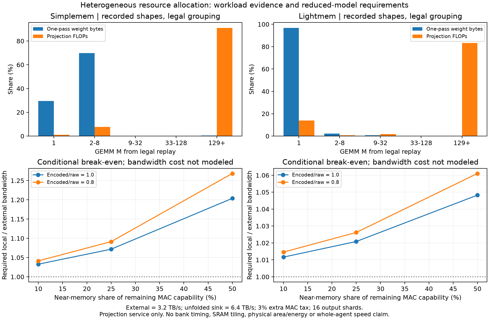

# 异构架构主线：计算域、数据归属与供数的共同设计

2026-10-16，承接 `e1ce26c`，按用户强调的异构 architecture 目标推进。

**主研究对象是矩阵计算域与近存流式计算域如何共享模型状态、分配物理资源。压缩与共享解码是供数子机制，不能独立替代异构架构贡献。** 固定 10 GB HB 副本仍关闭；不预设重新增加 HB、PIM 或带宽就获胜。

本轮完成 PDF 对照、真实形状/合法分组的计算与字节统计，以及统一/异构 × 原始/压缩的条件门槛筛查。没有新 A800 推理，没有新的同面积芯片加速结论。

**后续进展：** [接口/MAC 联合约束与有限块分析](BANK_SUPPLY_ANALYSIS.md) 已用 H²-LLM Table 6 约束接口和计算资源，并在真实新权重样本上比较本地/共享解码。共享池不再作为主机制推进；本页独立取算力/带宽的数值仍只是先前必要能力筛查，不能当作可实现芯片。

**研究层次调整：** 用户指出继续下沉局部实现会偏离主线；[第一性原理 overview](FIRST_PRINCIPLES_OVERVIEW.md) 重新比较按模型与按算子分域的前提，从容量、访问次数和生命周期推导物理机制。当前不预先锁定本页的算子级双域划分。

## 从本目录 PDF 得到的设计约束

页码为 PDF 页码。文件路径与 SHA256 见 [阅读回执](evidence/architecture/hetero_literature.json)，没有重新下载或公开上传论文 PDF。

| 本地论文与位置 | 真正需要借鉴的内容 | 对本研究的约束 |
|---|---|---|
| HybridSpec，pp. 2/4–6/9 | SD 改变 draft/target 的需求；容量与带宽共同决定硬件；Opr2 stationary 与通信重叠 | 应先证明算法与执行形状如何改变资源需求。不能复制其小 draft 能放进 HB 的前提，亦不能仅复制硬件方框 |
| H²-LLM，pp. 4–6/8/10/12 | 中央计算与近存计算访问共享权重；普通/NMP 模式；数据归属、算子分裂与控制器面积 | 本候选的直接架构基线。其以数据为中心的映射思路已经避免简单固定算子归属；双域、共享权重或算子分裂本身均非新贡献 |
| TETRIS，pp. 5–7 | 固定面积下 PE/SRAM 取舍、buffer bypass、数据复用与分区 | 省缓冲和加计算不能同时免费；局部供数必须有端口和数据流实现 |
| FGDRAM，pp. 2–4 | DRAM 内部数据搬运、共享总线与独立 grain 改变带宽/能耗 | 带宽来自实际 bank、总线和接口结构。压缩不能自动改善所有内部传输和激活开销 |
| Splitwise，pp. 5–7 | 阶段分离、KV 迁移及资源池调度 | 普通 P/D 分离是基线，域间数据移动和空闲资源必须计费 |

另核查 [Duplex §IV–VI](https://arxiv.org/html/2409.01141v1)：它已按 Op/B 选择 xPU/Logic-PIM，并用 bank bundle 组织并行访问；依赖与批处理影响两个域的利用率。[MemExplorer v2 §V-B/C](https://arxiv.org/html/2604.16007v2) 已做计算、存储、数据移动的联合设计，包含 P/D 分离及功率/封装约束。因此“加两个引擎再做 DSE”不能当新贡献。

Huff-LLM、ZipServ 及压缩感知控制器继续按 [上一轮说明](NEXT_CANDIDATE.md) 作为直接供数基线。**H²-LLM + 已有压缩的简单组合也是必须击败的组合对照**，不能只与无压缩统一设备比较。

## 先看硬件实际要做的工作

对投影 \(Y_{M\times N}=X_{M\times K}W_{K\times N}\)，BF16 下：

\[
F=2MKN,\quad U=2KN,\quad C=rU,\quad I_W=F/C=M/r.
\]

这里 U 是每次投影读一遍权重的逻辑字节，C 包括编码开销的受控字节数；不是硬件计数器读数。跨 M tile 的重读、SRAM 分块、激活、KV 等不能从 U 自动推断。实际 M 是合法分组后的行数，不是“Agent 数”或算法名称。

本轮提取已有六个基线分组场景。完整覆盖 SimpleMem 的 28 个 LLM + 31 个 Embedding 节点、LightMem 的 56 个 LLM + 261 个 Embedding 节点，并检查每个调用恰好出现一次、decode token 守恒为 O−1。保留 M=29 的合法维护分组；prefill 的 LM head 只处理末位置，所以同一前向也含小 M 操作。

下表取并发问答、维护不设线程池上限的**受控合法重放**，不是原生 CUDA batch 分布。分母包含该记录链中的全部投影与 Embedding 线性层，不含 attention。

| 工作量占比 | SimpleMem | LightMem |
|---|---:|---:|
| M≤8 的一次读权重字节 | 99.43% | 99.00% |
| M≤8 的 FLOPs | 8.89% | 14.74% |
| M≥129 的 FLOPs | 91.10% | 83.33% |

**这是异构配置的依据：少量并行行的操作贡献大部分权重消费次数，大行数操作贡献大部分乘加工作。** 它不说明一个域一定放 Construction、另一个放 Reasoning，也不证明拆分资源有净收益。合法分组、不同历史与部署会改变比例，其余 LightMem 维护/并发场景仍单独保留。



## 候选的物理组织与数据归属

| 组成 | 拟承担的工作 | 必须收取的代价 |
|---|---|---|
| 矩阵域 | 具有较多可并行行、较高复用的投影，及适合中央域的其他算子 | 阵列、复用 SRAM、压缩权重接收/解码；分走资源导致的性能损失 |
| 近存流式域 | 满足算力/供数条件的小 M 投影 | 向量/归约 MAC、bank 控制、解码输出和局部端口；不能只是换个 array 名字 |
| 共享权重容量层 | 一份权重分布在可寻址的 bank/通道，两域均可消费 | 完整模型容量、索引、布局、模式切换、冲突；不增加免费副本 |
| 域间通路 | 输入分发、输出收集、命令与同步 | fanout、真实链路、FIFO、延迟及能量；未证明可重叠的依赖不免费重叠 |

如果流式域只放在中央芯片的普通内存控制器旁，仍使用相同外存接口，其有效权重带宽可能没有提高。若希望借 bank 并行或垂直连接绕开共享通路，就必须像 FGDRAM / H²-LLM / Duplex 一样交代内部数据路径、接口与控制器成本。HB 是可选物理实现，非此阶段默认资源。

不将当前两个模型强行分配到两个域。每个算子的去向由实际 M/K/N、权重归属和可用资源共同决定。首个数值参考采用 N 维输出分片，各分片有完整 K，避免把跨域 K 归约藏掉；输入向 16 个分片分别发送，输出回中央域，未使用免费 multicast 或跨算子融合。

这个保守边界下，跨域激活字节为：

\[
A_{cross}=2M(qK+N),\qquad M_{traffic}=\frac{rKN}{qK+N}.
\]

仅在 M 小于这个值时，跨域激活字节才少于把编码权重送到中央域的字节；它不是性能交点。以 K=N=4096、q=16 为例，r 从 1 降到 0.8，会使这个字节交点从约 241 行降到 193 行。

**压缩既可能节省能量和容量，也可能减少移动计算的价值。** 同时，I_W=M/r 增大，近存 MAC 与解码输出必须更强才能消费同样的压缩输入带宽。不能只给异构侧压缩优势。

## 已跑的四组条件对照

比较 U/raw、H/raw、U/compressed、H/compressed。压缩系数 0.8 是显式场景，不将上一轮有限权重抽样外推成整个模型的实测压缩率。

两组均使用 519.08 TFLOP/s 总理论运算能力上限、3.2 TB/s 外部带宽锚点。H 先扣 3% 的额外控制能力预算，再把剩余能力的 10%/25%/50% 划给近存域；该扣除是敏感性参数，**不是已综合的面积或频率代价**。同一投影只选一个域执行，bank 不被同时免费授予两个域。

统一与异构都获得同样的展开权重输出能力 D；它包括解码输出和局部消费端口的最小供数上限。压缩流量需要 C/B 时间，展开供数需要 U/D，二者不能混用。近存执行另付跨域激活传输和每次 100 ns 启动；共享解码资源在这里没有免费并发。

本轮解的是**达到统一模型投影服务量所需的局部带宽**，没有将其免费赋给一个芯片并报告加速。中央/近存均使用理想乘加上限，未包括真实 SRAM 分块、bank 时序、attention、softmax、DAG 重调度、功耗和 PPA。因此它只是缩减模型内的门槛，**两个理想时延之比也不是实际加速比的数学上界或下界**。

代表结果（并发问答、维护不限线程；D=6.4 TB/s）：

| 近存算力份额 | SimpleMem：raw → compressed 的局部/外部带宽门槛 | LightMem：raw → compressed |
|---|---:|---:|
| 10% | 1.033 → 1.041 | 1.012 → 1.015 |
| 25% | 1.072 → 1.091 | 1.021 → 1.026 |
| 50% | 1.204 → 1.268 | 1.048 → 1.061 |

有三个实际决定作用的反例：

1. **相同权重带宽时，资源拆分没有收益。** 在本模型中 H 还付控制与激活搬运成本；“异构”标签本身不产生优势。
2. **展开端只有 3.2 TB/s 时，六种场景都没有有限的局部 DRAM 带宽可抵消拆分损失。** 限制发生在解码/消费端；继续增加压缩输入带宽无用。这是模型条件，非实测 decoder 结论。
3. **压缩给统一侧相同好处后，异构门槛升高。** 将一半算力分到近存，SimpleMem 的门槛从约 1.204 提高到 1.268；不能说压缩天然增强异构优势。

展开端 6.4 TB/s 在 16 个均匀分区下相当于每区 400 GB/s、约 200 个 BF16 权重/周期（1 GHz）。这还没有获得面积/频率证据。H²-LLM Table 6 已示范较高 HB 带宽会挤占可放的 FPU，不能拿论文某个峰值带宽直接满足这里的要求。

## 下一步明确落在架构上

下一步只细化这一组织：**共享模型 bank 上的矩阵/近存两种消费模式，及压缩块如何经过控制器、解码与局部端口。** 共享解码池继续是待比较的子候选，尚无证据证明它优于固定解码器。

用有限 bank、FIFO 和地址映射替换上面的局部供数门槛，计入 bank 模式切换、码块长短、索引读取、控制器/解码/端口面积与 MAC/SRAM 挤占。固定相同容量和一个主要成本预算，功率/面积作为约束；不同时强迫各种存储等容量等成本等带宽。最终比较至少包括优化统一架构、普通 P/D、H²-LLM 类共享状态异构、已有压缩对照及其组合。GQA packing 和合法大 batch 同样给所有方案。

需要证明的新增量是具体物理供数或状态组织能改善完整记录链的净成本；仅重现 H²-LLM 的映射或 Huff-LLM 的解码，就采用它们作为基线并停止该新增机制。原来共享解码子候选的停止条件继续有效，不能通过“我是异构方案”逃避与已有组合比较。

新文件：[模型](architecture/hetero_boundary.py)、[数值与守恒检查](hetero_boundary_unittest.py)、[分组投影形状](evidence/architecture/hetero_projection_shapes.json)、[全部条件结果](evidence/architecture/hetero_boundary.json)、[PDF 图](evidence/architecture/hetero_boundary.pdf)。

```bash
python3 -m unittest hetero_boundary_unittest weight_codec_unittest
python3 -m architecture.hetero_boundary
python3 -m architecture.plot_hetero_boundary
```

11 项检查通过；其中 7 项针对新模型，涵盖 N 分片数值参考、输入 fanout、扩张码块、同供数反例、输出端限制、门槛两侧和调用/token 守恒。旧 HB 模型与报告未修改。本轮没有完整芯片或完整 Agent 性能结论。
