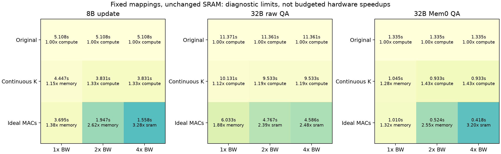

# 算存联合机制：交叉诊断、计费映射与表示归因

本轮完成三项交付：阵列×带宽的 3×3 控制（固定/重新映射各一组）；有供数、归约、缓冲和接口代价的 K 分片候选；输入/输出四组合及 7 个细粒度原文查询。**单独改善阵列的 1.38× 不是算存联合改善的上界。** 但当前外存预算内，初版 K 分片相对连续 K 的强统一基线只有小幅增益。

旧 `7cd9029` 的模型、账本、配对数据均保持冻结。新代码在 [mechanism.py](architecture/mechanism.py) 中扩展，新结果与旧基线逐项对齐。没有续开 Mem0 构建或修改原始数据库。

## 1. 阵列改善后，高带宽开始有用

图中列是 DRAM 带宽倍数，行是原映射、连续 K、理想有效 MAC 周期。SRAM 服务始终保留；标签是逐算子限制归属的累计时间最多者，不能把整条路径视为单一算子的 max。

对于 update，固定映射下：

| 阵列控制 | 原带宽 | 2× 带宽 | 4× 带宽 |
|---|---:|---:|---:|
| scheduled | 5.107952 s (compute) | 5.107952 s (compute) | 5.107952 s (compute) |
| continuous_k | 4.447477 s (memory) | 3.831184 s (compute) | 3.831184 s (compute) |
| ideal | 3.694806 s (memory) | 1.946574 s (memory) | 1.557523 s (sram) |

理想阵列＋4× 带宽相对原 5.108 s 的诊断空间约 **3.28×**；SRAM 成为下一项限制。连续 K＋2× 带宽也有改善，随后再次受阵列限制。对应全部 9 次 update、14 次真实问答的逐请求数值及重新选 tile 的结果都保留在 JSON。

理想计算和 2×/4× 带宽没有计新增硬件成本，因此**只用于确定联合方向**。它们未进入下节的预算内方案排名，也不代表新 NPU 实测速度。

## 2. 从流量看：权重重要性上升，不能混同驻留和读取

以下是原映射下，每条请求整个 decode 阶段的平均 **DRAM 逻辑流量 GiB**；不是存储容量，也不是 A800 硬件计数器。权重/KV/激活/部分和读写分别核算，并逐算子对账到总 read/write bytes。

| 路径 | 权重读 | KV 读 | 激活读 | 部分和读 | 部分和写 |
|---|---:|---:|---:|---:|---:|
| 8B update | 10359.493 | 248.268 | 5.467 | 0.000 | 0.000 |
| 32B raw QA | 4961.661 | 429.800 | 2.774 | 0.000 | 0.000 |
| 32B Mem0 QA | 2893.593 | 3.189 | 1.618 | 0.000 | 0.000 |

短记忆的 KV 下降，但 32B 投影仍每步消费权重。模型中每 decode 步的投影权重读约 59.57 GiB；实际常驻权重为 61.024 GiB，两者不同，因为查表 embedding 等常驻参数不等于每步遍历的投影矩阵。长 prefill 还存在 OS 权重重读或 WS 部分和溢写，完整分类见 JSON。线性 K/V 投影生成的写入归入 activation_write，没有另外重复收取一次 KV 写入；KV_read 指 attention 读历史缓存。这里不能用常驻 61 GiB 直接宣称实测每步读取了 61 GiB。

## 3. 一个带代价的 K 分片候选

设计与公式见 [K_SHARD_DESIGN.md](K_SHARD_DESIGN.md)。固定一份权重，将物理阵列行分为 g 个 K 分区，每区输出 FP32 部分和；局部树合并后写回。仅 M=1 投影使用该映射，attention 保留原实现；若原映射更快则回退。两种模式共享 MAC 和 SRAM，新增复用器、地址发生器、归约通路及全局频率损失照常计入。

代码包含可执行的分片/二叉归约参考实现，覆盖 K/N 尾部；这证明运算语义及计数，不等于 RTL、浮点位精确或布局布线验证。

在原有 **850 成本、450 mm²、500 W、50 mm 接口**的条件预算内，枚举 96 个配置，含 32 个强统一基线和 64 个带代价候选。此处不免费增加 DRAM 带宽。强基线允许连续 K 并独立选择最快 OS/WS tile。

| 真实工作负载 | 最佳强统一基线 s | 最佳 K 分片 s | 基线 / 候选 | K 分片配置 |
|---|---:|---:|---:|---|
| 8B update | 4.441615 | 4.361863 | 1.0183× | `HBM3E4_a16_128x128_s128_k2` |
| 32B raw QA | 9.740032 | 9.759467 | 0.9980× | `HBM3E4_a16_128x128_s32_k2` |
| 32B Mem0 QA | 1.045020 | 1.033176 | 1.0115× | `HBM3E4_a16_128x128_s32_k2` |

因此，**现有外存条件下，不能用初版 K 分片宣称明显的架构突破**。原文路径甚至因新增控制/时钟成本略慢。需要保留的现象是：改变映射后额外带宽开始有效，而且最佳 K 分片数并非越大越好。

下表固定 HBM 参照与短记忆真实请求；2×/4× 列仍是未计带宽成本的诊断：

| K 分区数 | 原带宽 s | 2× 带宽 s | 4× 带宽 s |
|---|---:|---:|---:|
| 2 | 1.033176 (memory) | 0.569020 (memory) | 0.508082 (compute) |
| 4 | 1.033500 (memory) | 0.576459 (memory) | 0.452005 (sram) |
| 16 | 1.036559 (memory) | 0.666610 (memory) | 0.478959 (sram) |
| 64 | 1.047070 (memory) | 0.855590 (compute) | 0.780498 (compute) |

过多 K 分区增加 FP32 部分和与归约传输，也无法绕开固定 SRAM 端口。所有候选都有明确额外硬件代价，但面积/布线/频率系数尚未综合校准；下面的敏感性用于暴露这一局限。均为参照配置、g=2、短记忆路径。

| 控制 | 服务秒 | 模型能量 J | 成本单位 |
|---|---:|---:|---:|
| nominal | 1.033176 | 128.97 | 739.310 |
| bank_skew2 | 1.033176 | 128.97 | 739.310 |
| bank_skew4 | 1.044285 | 129.43 | 739.310 |
| overhead4 | 1.033176 | 130.38 | 744.631 |
| uncoalesced_refills | 1.034420 | 129.02 | 739.310 |
| clock_drop_5pct_per_level | 1.036653 | 129.12 | 739.310 |

面积系数变化可能只影响成本/能量而不影响该点时间，不能以时间稳定证明 PPA 稳健。搜索空间仍只有既有 HBM/LPDDR 配置；没有 HB-on-Logic 域、层间通信或新封装，不能把 4× 带宽解释成已设计好的 HB Stack。

## 4. 输入缩短与输出改变分别贡献多少

在同一原 HBM 映射上，对每个问题组成四个 L/O 组合，实际两端保留其真实输出；中间两点只用于核算归因。

| L 来源_O 来源 | 证据类型 | 模型服务秒 |
|---|---|---:|
| raw_raw | 实测形状 | 11.371168 |
| mem0_raw | 反事实组合 | 2.260079 |
| raw_mem0 | 反事实组合 | 9.350124 |
| mem0_mem0 | 实测形状 | 1.335367 |

平均两种改变顺序的边际差额，输入贡献 8.563 s（85.3%），输出贡献 1.473 s（14.7%）。这是四点模型分解，不是实测因果干预，也不是质量等价的加速。连续 K 与 K 分片下的分解亦保存，结论量级相近。

在本轮资源网格中，四种形状组合都仍选择 HBM 系列；没有发现内存技术排序反转。跨表示的强统一基线与候选的相对差异也很小。**输入变化改变工作量和瓶颈，不自动证明硬件最优点发生了显著反转。**

## 5. 质量和普通检索控制

[独立报告](REPRESENTATION_CONTROLS.md) 完成两例检查及 512-token 原文检索。原文平均输入从 21151 降到约 2570 token，说明 2.1 万输入不是原文路径不可避免的成本；但时间锚点和多条支持事实可能丢失。这些质量问题限制跨策略收益，**不阻止在同一真实请求上比较硬件映射**。

H²-LLM §4.2 已讨论 K/N 划分的部分和合并与输入复制取舍，不能将 K 分片本身作为新贡献；TETRIS §3.3–4 的存储/累加和资源取舍也是相关先例。这里的候选只是验证工具，尚未复现两者的完整硬件。文献与差异见设计说明。

模型仍未覆盖 softmax/normalization 等 vector kernels、实际 bank/row-buffer 时序及并发到达队列；面积、网络和频率没有综合校准。因此约 1–2% 的预测增益尤其不能当作稳健 PPA 结果。部分和重排也尚未通过完整 LLM 的数值/质量验证。

可保留的机制假设是：**记忆表示减少阅读历史和 KV，却保留大模型投影；映射、外存供给、SRAM 及归约必须联合匹配。** 下一步若要主张新设计，应把有利的联合诊断点替换成真正满足预算的供数路径，并证明相对强统一映射的增量；当前小增益不能替代这一步。

复现：`python3 mechanism_unittest.py`，`python3 -m architecture.joint_diagnostics`，`python3 -m architecture.report_mechanism`。机器结果：[joint_diagnostics.json](evidence/architecture/joint_diagnostics.json)。
