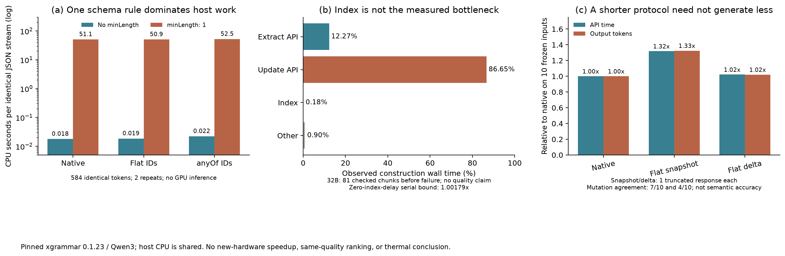

# 协议开销与完整路径验证：第二、三轮

**目前最确定的新发现是一个软件开销来源，而不是新的存储瓶颈。** 固定 xgrammar 0.1.23 中，给输出文本增加 `minLength: 1` 会让相同 JSON token 流的 CPU 约束匹配慢约三个数量级。这项开销不能算作 GPU decode 或带宽需求。完整 Mem0 的修正实验仍在后台运行，尚未取得同质量架构胜出结果。

**原生 32B 也会混淆输出位置和已有 ID。**

第二轮使用原生 Mem0、Qwen3-32B 构建及回答、0.6B embedding，启用 prefix cache。计划处理一个真实历史的 88 个构建片段和 60 个问题。第 82 个片段失败，已有记忆编号为 0–44，模型要求 UPDATE 51、63、64、66；这四个数字恰好分别是它们在输出列表里的位置。

这否定了“只换成 32B 就能消除原先 ID 错误”的判断。它不表示更大模型在所有任务上无效，也不表示合法引用就保证语义正确。

旧 runner 先写 `steps.jsonl` 再检查错误，旧收尾汇总因此把失败的最后一步也算进了 82 个“完成块”。原始文件保留，修正汇总为 **81 个通过结构检查的片段 + 1 个失败片段**；整体仍无效，不能用于完整质量或算法成本排名。新 runner 在步骤中显式记录 `passed/failed`，并在 manifest 中记录失败位置。

这 81 个片段共约 4,162.55 秒：extraction API 510.77 秒，update API 3,606.77 秒，索引 search/insert/update/delete 合计 7.435 秒。索引约占 **0.1786%**，在保持这条串行执行路径的条件下，完全消除索引延迟的上界仅 **1.00179×**。这只否定当前规模上的索引加速动机；没有推断大规模索引的表现。API 时间包含服务软件，不能直接标成 GPU kernel 时间。

证据：[纠正后的第二轮汇总](evidence/phase2/completed/corrected_completed_observation.json)。旧的 `completed_observation.json` 保留用于审计，不再作为完成块数的依据。

**严格 schema 的慢速来自哪里。**

第二轮对 10 个真实冻结 update 输入进行无写库重放：

| 控制 | 请求时间合计 | 输出 token 合计 | 与原始输出的变更操作完全一致 |
|---|---:|---:|---:|
| 原生 | 112.93 s | 8,052 | 9/10 |
| 合法 ID 分支 schema，含 `minLength: 1` | 741.53 s | 8,052 | 9/10 |
| 同一严格 schema，仅输出变更 | 334.66 s | 4,519 | 6/10 |

这些请求可能与 GPU0 embedding 重叠，因此表格不作为不受干扰的硬件时延排名；它提出了需要隔离验证的软件疑点。操作一致性是对原始模型输出的比较，原始输出不是语义真值。

第三轮以同一个真实请求的 JSON 输出为基础，将 ADD 的无用 ID 统一成占位符，再固定序列化和 tokenization。**每个 schema 都重放同一份 584-token 流**，只运行 CPU 上的 `fill_next_token_bitmask + accept_token`，不运行 LLM/GPU。交叉比较三种 schema 结构及有/无 `minLength: 1`，正反顺序各一次，全部 token 都被各自 grammar 接受：

| schema | 无 minLength：CPU 秒 | 有 minLength：CPU 秒 |
|---|---:|---:|
| 原生结构 | 0.0179 | 51.0594 |
| 简单 ID 枚举 | 0.0186 | 50.8543 |
| 条件 ID 分支 `anyOf` | 0.0223 | 52.4561 |

数值是两次测量的中位数；共享 CPU 主机上的墙钟和 process CPU 时间接近，但不是独占节点的性能结论。编译时间单独记录，未混入上述逐 token 匹配时间。较早的多输入重放在得到完整的这组因果对照后提前停止，保留其部分记录和停止回执，不标为完成实验。

源码还支持“规则走了不同转换路径”的解释：[xgrammar v0.1.23 的字符串转换](https://github.com/mlc-ai/xgrammar/blob/v0.1.23/cpp/json_schema_converter.cc) 对 min/maxLength 构造带重复次数的字符类，而普通字符串走 basic-string 路径。尚未通过 C++ profile 进一步分解具体内部函数，**不声称已经证明逐 token 全词表扫描或普遍版本缺陷**。

这不是所有 constrained decoding 都很慢：同一环境中的另外三组 schema 很快。新控制把非空文本检查放在完整输出之后、所有写库之前执行，并且仍在生成阶段约束 JSON 和 ID 范围。

证据：[第三轮固定观察，含完整 3×2 CPU 对照](evidence/phase3/observation_03.json)；脚本 `grammar_factorial.py`；[可导出 PDF](evidence/phase3/protocol_diagnosis.pdf)。

**去掉慢速规则也不保证输出协议有效。**

第三轮冻结输入重放已经完成，模型仍是 8B。对每个输入交替控制顺序：

| 控制 | API 时间合计 | 输出 token | 截断响应 | 与原始变更操作完全一致 |
|---|---:|---:|---:|---:|
| 原生 | 104.21 s | 8,052 | 0/10 | 9/10 |
| 简单 ID 枚举 + snapshot | 137.39 s | 10,672 | 1/10 | 7/10 |
| 简单 ID 枚举 + delta | 106.45 s | 8,217 | 1/10 | 4/10 |

因此，“不输出 NONE”没有在这批输入上自动带来更少 token 或稳定的更快执行。Prompt/schema 改变了生成行为，且有截断；不能将其当作无损协议优化。没有对这些冻结重放执行数据库写入。

该早期冻结实验的 validator 还要求 ADD 的占位符必须为 NEW，产生了额外拒绝；但源码显示 ADD 的 ID 被忽略，NONE 也不解引用 ID。这些拒绝不是数据库引用错误。完整运行之前已经修正为：只对 UPDATE/DELETE 检查真实引用及冲突；不因无用占位符不同制造失败。旧记录中的此类 `parse_error` 不可直接当作模型失败率。

**完整运行及采集器修复。**

写库前校验完整操作集，失败时最多两次重试；所有尝试均计入请求、token 和服务时间。合法输出之后才进入上游写入循环，这避免无效引用导致部分写入，但不是数据库 ACID 事务，也不保证语义质量。

第一次第三轮 8B delta 在第 14 个片段被采集器竞态中断：SSE 已返回，但代理尚未把 API 回执写完。原始响应复查合法，故这次失败归因于本项目的校验器，不归因于模型。snapshot 运行随后被主动中断，避免重复已知采集错误。新的 `_v2` 运行从干净状态重新开始，不继承失败状态。

修复后的读取只接受完整 JSONL 行，并短暂等待 SSE 回执。测试覆盖整组先校验后应用、无效引用、重复修改、截断 JSON、合法 ADD/NONE 的忽略 ID 语义、有限重试，以及有效 JSON 但 token cap 命中的重试记账。模型源码、运行脚本和软件控制的哈希都写入运行目录。

后台顺序为：8B delta → 8B snapshot → 32B delta，每个都计划 88 个片段 + 60 个问题；结构校验完成后才做词法评分与实际查询 KV 统计。`pipeline_recovery.json` 区分各项成功、失败和采集结束；结束后核对服务 PID 并释放 GPU。这里的“结束”不表示架构 motivation 完成。

最新固定观察 [observation_05.json](evidence/phase3/observation_05.json)：采集器修正后的 8B delta 完成 16 个片段，第 17 个片段连续三次命中 4,096-token 上限，判无效；8B snapshot 当时通过 19/88 个构建片段，尚未开始 QA。前者是该协议配置的生成失败，与之前第 14 个片段的采集器竞态分开记录。

另外已排队 `operations/start_guarded.py`：等待当前 suite 结束并释放服务后，再运行保留原生提示词的 `guarded_native` 控制。它只给操作引用增加条件 schema，去掉 minLength；不强制 ADD 使用某个无用占位符，也不要求 delta 输出。先尝试 8B，只有完整结构有效性失败才以 32B 作有界回退。成功完成后报告词法指标与 KV 容量账；这仍不能代替独立语义质量评价。[排队回执](evidence/phase4/queued_pipeline.json) 仅证明已进入等待，不能当成 phase4 已完成。

缓存元数据口径也已纠正：当前 vLLM API usage 没有提供 cached-token 字段。新快照记录有该字段的调用数，缺失表示未知；早期快照中默认累加的 0 不可解释成 prefix cache 没有命中。

**对架构问题的改变。**

当前不再用输出 token 比例推断硬件瓶颈，不再把索引列为当前规模的主热点，也不把额外 8B 权重单方面当作容量损失。要联合核对：构建费用、查询复用、语义记忆缩短上下文节省的 KV、额外权重及构建 KV、状态可见性与更新频率。完整第一性原理分析和反证条件见 [OVERVIEW_NEXT.md](OVERVIEW_NEXT.md)。尚未进入同预算新硬件胜出、银行级访存或热优化的结论阶段。
