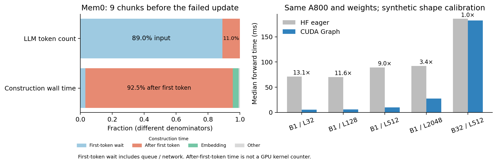

# Agent Memory 架构动机：第一轮反证结果

本文保留第一轮结果。后续的原生 32B 失败、schema CPU 因果对照和后台修复运行见 [第二、三轮结果](PHASE23_RESULTS.md)。

**当前证据不支持把“Construction 输入多、Embedding 模型小”直接转化为新异构硬件的动机。** 本轮得到可复现的模型有效性失败、执行方式对照和时间占比反证。它们只约束这里的模型、版本和样本，不是所有 Agent Memory 场景的结论。

后续只读诊断进一步定位了更新调用中的 NONE 重述、输出位置与记忆 ID 混淆，以及 GraphRAG 的重复生成；见 [原因分析](CAUSES.md)。

实验遵循算法→计算/访存/容量/依赖→瓶颈→架构的顺序。尚未报告新的 NPU/HB/PIM/HBF 性能排名，也没有加入热优化。相同预算 DSE、成熟架构基线和温度反馈尚未完成，不能从以下刻画结果直接宣称 architecture contribution。

**固定对象与证据范围。** 使用 `Tambe-Lab/agent-memory-profiling@30a157b7b49f732ee4b961cb19d7f877cf475f81` 的真实实现。Mem0 是其 vendored 版本；GraphRAG 是该仓库的 NetworkX/LangChain 实现。模型为 Qwen3-8B Construction、Qwen3-Embedding-0.6B、Qwen3-32B Answering，均固定 checkpoint revision、BF16、关闭 thinking。数据是 MemoryAgentBench 固定 revision 的第一个完整 LongMemEval record：约 160 万字符、88 个外层构建片段、60 个问题。tiny fixture 仅用于连通性检查。

**1. 输入 token 多，未必意味着 Construction 的时间主要用于 Prefill。**

Mem0 在第 10 个片段失败。下面只统计失败前 9 个没有报错的片段，不视作完成了整个 workload 的质量验证：

| 实测量 | 结果 |
|---|---:|
| LLM 调用 / Embedding API 调用 | 18 / 88 |
| LLM 输入 / 输出 token | 61,415 / 7,586 |
| 输出 token 占 LLM token 总数 | 10.99% |
| 构建墙钟时间 | 180.37 s |
| 首 token 等待之和 | 5.65 s |
| 首 token 之后的生成时间之和 | 166.84 s，约占构建时间 92.50% |
| Embedding 请求时间区间之和 | 6.36 s |

这里的首 token 等待包含排队、网络和首 token 生成；首 token 后的时间也不是 GPU kernel counter。实际串行调用链允许做一个宽松的 Amdahl 上界：即使把**全部首 token 等待与 Embedding 时间同时归零**，这 9 个片段也最多加速

\[
S_{\max}=\frac{180.37}{180.37-5.65-6.36}\approx1.071.
\]

它否决的是“仅加速 Prefill 与 Embedding 就能明显改善这个串行构建配置”的动机。多 Agent 并发、批处理和其他模型未被该上界覆盖；不能把结果扩大为所有 Construction 都具有相同瓶颈。

与此相对，已完成的 EmbedRAG 60 次问答，LLM 共读取 1,247,743 tokens、输出 1,521 tokens。查询步骤共 628.42 s，其中首 token 等待合计 536.47 s（约 85.37%），首 token 后为 81.32 s。本样本每次检索返回长上下文、答案很短，因此角色名称对应的时间特征恰好与最初假设相反。这里仍然不能把首 token 等待直接当作纯 Prefill；其资源差异首先属于普通输入/输出长度与 P/D 配置问题，尚不构成 Agent Memory 独有机制。

**2. 小批量 Embedding 的慢速不能直接解释为需要专用高带宽硬件。**

同一 A800、同一模型和输入，保持原生 attention mask，在 eager 与 CUDA Graph replay 间对照：

| Batch / 长度 | Eager 中位数 | Graph 中位数 | 比值 |
|---|---:|---:|---:|
| 1 / 32 | 71.05 ms | 5.41 ms | 13.14× |
| 1 / 128 | 70.19 ms | 6.05 ms | 11.60× |
| 1 / 512 | 89.40 ms | 9.89 ms | 9.04× |
| 1 / 2048 | 92.31 ms | 27.48 ms | 3.36× |
| 32 / 512 | 185.84 ms | 182.54 ms | 1.02× |

这是固定形状的合成 token **校准**，不是把真实 facts 人为复制成大 batch 的 workload 证据。掩码对照输出一致，graph replay 通过数值检查；capture/warmup 成本不包含在稳态 replay 时间内。它证明初始延迟存在可由执行方式消除的巨大开销，不证明原生可变长度请求必然获得同样加速，也不替代 DRAM 硬件计数器。

8 个形状的非负“固定开销＋dense FLOPs＋attention FLOPs”拟合，留一形状验证的相对误差中位数为 2.40%、最大为 16.23%。这只是 A800 内部的形状插值校准，不能用来推断新 NPU、SRAM 数据流或 HB 带宽变化后的性能。

**3. Mem0 的部分串行执行可以由软件改变，但数值与质量约束必须保留。**

实际路径是：抽取 LLM → 每条 fact 的 Embedding 与旧记忆搜索 → Update LLM → ADD/UPDATE/DELETE/NONE → 数据库。候选 fact 搜索结束前没有记忆写入，因此这段编码可作为独立批处理候选；Update 之后重新编码待写入文本的调用具有另一种依赖，已排除在批处理对照外。

使用前 9 个片段的 **78 条真实候选 fact、9 个原生组**，串行与组内批量编码各测 3 次。组级加速中位数为 **3.55×**；最小向量余弦相似度约 **0.999768**；冻结索引上的加权 top-5 集合重合率为 **99.7436%**，完整排序一致率为 **93.5897%**。

这支持把普通批处理纳入强基线，但不满足“检索结果严格不变”。冻结索引来自失败运行结束后的状态，此对照只检查数值/排序变化，不是最终问答准确率或完整 Mem0 加速实验。批处理后的端到端质量仍需单独验证。

当前 upstream Mem0 `0724291...` 的主流程已经包含单次抽取和 `embed_batch` 接口。OpenAI provider 实现真实 API batch，基类及部分 provider 则仍回退到逐条调用。版本与 provider 都会改变执行特征，不能把旧 artifact 的循环概括成 Mem0 的固有硬件需求。

**4. 8B Construction 尚未通过正确性门槛。**

Mem0 第 10 个片段的已有记忆 ID 只有 0–24，8B 输出却要求删除 31、39、40。JSON 合法，但引用无效。上游会记录错误后继续执行；实验 runner 将其判为失败，保留部分写入状态且不继续拿该状态做正常问答评价。

固定同一个原始请求重放两次：8B 均复现三个无效 ID，耗时 30.97/30.65 s；32B 两次均没有无效引用，耗时 76.81/73.43 s。两种模型的输入均为 2,228 tokens，输出分别为 1,443 和 1,397 tokens。**这只是该请求的引用有效性对照，不是 32B 完整记忆质量通过的证明。**

GraphRAG 对完整历史形成 617 个内部片段。经过常规批量 NER 调度控制后，概念抽取仍有 6 次调用达到 1,024-token 输出上限，无法解析完整结构化结果。该构建也判无效，未继续问答。增加 token 上限、修改生成设置、重试或模型回退都可能改变结果，但必须重新计入成本和验证质量。

**完整简单检索基线。** EmbedRAG 和 BM25 都完成了 88 个片段的构建及 60 次问答，通过独立 API 记录核对，无请求失败或生成截断。两者都不需要 Construction LLM。

| 测量项 | EmbedRAG `embed_full_01` | BM25 `bm25_full_02` |
|---|---:|---:|
| 构建及索引完成步骤 | 13.84 s | 0.51 s |
| 60 次查询步骤 | 628.42 s | 644.37 s |
| Runner 完整记录窗口 | 646.62 s | 649.06 s |
| 词面 token F1 | 19.81% | 22.74% |
| 规范化答案子串匹配 | 38.33% | 46.67% |
| 两张 GPU 的设备总能量计数器增量 | 228.75 kJ | 230.97 kJ |

这些是模型服务已经启动后的测量，不含模型加载和 Python 导入；完整记录窗口另计初始化、保存及记录开销。查询均为 Qwen3-32B、top-5、单条串行执行。EmbedRAG 索引构建的一次 API 请求包含 88 个序列，实际拆为 32/32/24 三个 GPU forward；不是 batch 88 的单次 kernel。

BM25 初次运行在第 34 个问题碰到 256-token 上限。固定请求重放在 270 tokens 正常结束，故另建 `bm25_full_02`，将上限改为 1,024 后完整重跑；旧失败记录没有删除或拼接。EmbedRAG 的上限仍为 256，全部正常结束。**这份表是各自配置的测量记录，不是同质量、同参数的算法性能排名。**

评分使用上游 LongMemEval 后处理：对原始及解析后的回答取各词面指标的最大值，并另存原始评分。规范化 exact match 两者均为 0；尚无独立语义评判，不能据此认定语义正确率或质量等价。两个有效基线均只有一个完整 record，也没有重复运行的置信区间。没有通过构建的 Mem0/GraphRAG 不参与有效成本排名。

序列化 `state` 分别为 1,990,198 / 3,312,590 bytes，另有 5,525,958 / 5,625,494 bytes 的缓存文件；这些不是 CPU 峰值工作集。此规模未形成大容量 memory index 的压力，不能支撑分层 SSD/DRAM 放置的优越性。

**容量核对。** 固定 BF16 权重分别为 Embedding 1.110 GiB、8B 15.256 GiB、32B 61.024 GiB，合计 **77.390 GiB**。A800 实际容量为 80 GiB。配置推导的 BF16 KV 为 8B 每 token 144 KiB、32B 每 token 256 KiB；32K 上下文对应 4.5/8.0 GiB，尚未计入 allocator 和 workspace。这个约束首先要求比较普通模型驻留、KV 管理和容量扩展方案，并不自动支持某种 3D 存储技术。

**与成熟工作的关系。** [BASELINES.md](BASELINES.md) 逐项核查统一 GPU/NPU、优化 P/D 分离、容量/KV 管理、[MemExplorer](https://arxiv.org/abs/2604.16007)、[KEEP](https://arxiv.org/abs/2602.23592) 和 [TokenCake](https://arxiv.org/abs/2510.18586)。KEEP/TokenCake 的代码已固定版本并检查，尚未完整原生复现。这里的执行方式对照、批处理对照和理想时间消除上界不能冒充这些完整系统的复现，也没有形成超越它们的性能证据。

当前 corpus 是离线构建后问答，不能证明在线新鲜度收益、真实工具等待分布或多 Agent 并发效果。没有制造到达率来包装为实测。也没有面积/成本校准、银行级访问轨迹或 3D 功率密度模型，因此架构 DSE 和热反馈继续停在证据门槛之前。

**本轮 Gate 判定。**

| 可证伪假设 | 实测判定 | 限定范围 |
|---|---|---|
| Construction 的输入 token 占多数，所以时间主要用于 Prefill | 该推断被本样本否决 | Mem0 失败前 9 个片段；92.50% 墙钟位于首 token 之后 |
| 单条 Embedding 很慢，因此需要新高带宽硬件 | 证据不足，执行方式控制可解释大部分初始延迟 | 相同 A800 固定形状 Graph 对照；尚未验证可变长度部署收益 |
| fact 串行编码是算法无法消除的硬件需求 | 串行性并非全部必要 | 78 条实际 facts 可组内批处理，但检索排序有小幅变化 |
| 固定 8B Construction 足以支撑后续架构比较 | 当前配置未通过 | 一次真实无效引用及两次重放；不是所有 8B 模型均失败 |
| Agent Memory 独有失配在成熟软件基线、同预算下仍成立 | 尚未证明 | 不能据此宣称异构架构无效，也不能报告新架构胜出 |
| 3D 热约束会改变最优架构 | 未检验 | 没有空间功率、温度及性能反馈链，不纳入本轮结论 |

下一道门槛是完整、有效的记忆构建与质量评价，然后在真实读写依赖下检查剩余瓶颈。需要把模型回退/重试的代价计入，并比较当前 Mem0 的批处理实现、优化 P/D 与容量/KV 管理；这几项尚未满足，不进入 HB/PIM/HBF 资源分配或热优化。

**环境与复现边界。** GPU 是 2× A800 80 GiB；主机 CPU 被其他用户任务高负载共享。CPU 墙钟时间不代表独占节点性能。GraphRAG 的上游 profiler 在本 SDK 的 structured-parse 路径中出现 completion token 总计为 0 的计数缺口，最终统计以独立 router 原始响应为准。API 延迟、GPU 时间、并发请求延迟之和与阶段墙钟均分开记录。细节见 [COMPATIBILITY.md](COMPATIBILITY.md)。

NVML 记录包含两张 GPU 的设备总能量，计入闲置但仍驻留的模型服务，不包含 CPU/DRAM 或整机能量。瞬时功率采样存在高于 300 W 配置上限的读数；这些原始值保留并单独核查，不据此推算持续功率密度、单操作能耗或温度。两次完整运行中，功率采样积分与能量计数器增量相差约 0.08%–0.25%，只说明设备遥测内部基本一致，不等同于独立功率计校准。

原始请求、状态、功率采样和失败回执位于 `moe-server:/data/ziheng/agent-memory-architecture/outputs`；本地只保存小型汇总与图。模型通过镜像下载，revision 与数据哈希固定。代码已提交并推送到同服务器的独立 Git bare repository。本轮模型服务已经停止，GPU 占用已释放，模型与原始证据保留。

证据入口：[执行与评分汇总](evidence/final/run_summary.json)、[完整性核验](evidence/final/validation.json)、[原始证据哈希](evidence/final/raw_artifact_sha256.json)、[固定请求重放](evidence/final/failed_update_replay_summary.json)、[批处理对照](evidence/final/fact_batching_summary.json)、[功率遥测核查](evidence/final/power_measurement_audit.json)、[可导出 PDF 图](evidence/figures/motivation_falsification.pdf)。`evidence/pilot/` 是较早的中间快照，最终统计以 `evidence/final/` 为准。早期 Mem0 manifest 未记录 runner 哈希，此缺口保留为 null；不将后来脚本的哈希回填成历史来源。

此前授权清理也已验证：`bsf-worktrees`、EDA/chiplet 目录和 `/data/ziheng/jhn/detailedrouter` 已删除。仅 `/data/ziheng/ecc-olmoe-pilot-Dkz9Dq/__pycache__` 下 root 拥有的缓存无法以当前账号移除；清理回执保存在 `evidence/cleanup/`。
