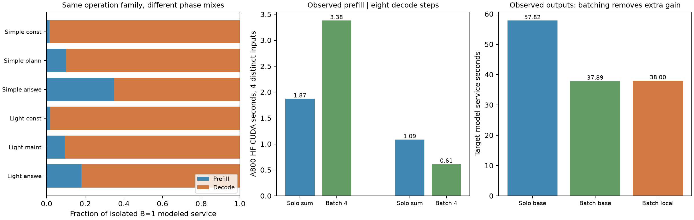

# 共同执行模式、固定硬件复核与合法批处理反例

**本轮已取得 SimpleMem 与 LightMem 的有边界原生执行记录，并将同一供数候选直接用于这些新请求。两者都包含大量生成操作，但合法批处理足以消除当前候选在 SimpleMem 构建组上的额外优势。因此，共同工作负载成立，当前 M=1 局部供数机制尚未证明整类负载上的稳健收益。**

本报告与 [供数路径结果](SUPPLY_PATH_RESULTS.md) 是本轮两条工作线的合并交付。旧 Mem0、KShard 与 `35e6e9e` 的 model/spec/mechanism/joint_diagnostics 不改动；没有重开协议修复，没有新建 SSD/HBF/热支线。

## 1. 本轮实际运行了什么

SimpleMem 和 LightMem 使用同一个 LongMemEval record 的前 **48 条原始消息**，保持角色、时间戳和原始顺序；时间戳单调性、相同历史 SHA 已核验。前三个原问题只作为查询执行探针，**没有证明它们均可由这段有限历史回答**。因此，不评价跨算法质量，也不把这三个答案当完整基准结果。

| 项目 | SimpleMem | LightMem |
|---|---|---|
| 代码版本 | characterization artifact `30a157b7b49f732ee4b961cb19d7f877cf475f81` 中的 SimpleMem | 官方代码 `8449d574df6bae1bdf3314a1564da65e2f37e046` |
| 入口 | 原生 `SimpleMemSystem`、构建、hybrid retriever、answer generator | 原生 `LightMemory.add_memory`、offline queue/update、retrieve |
| 受控配置 | window=16、overlap=2、4 构建 workers；planning、reflection、并行检索开启 | flat extraction、offline update；buffer 使用原生默认；队列 4 workers、维护 5 workers |
| 记忆记录 | 49 条 | 维护前后均 258 条 |
| LLM 调用 | 28：4 构建 + 21 查询规划/反思 + 3 回答 | 56：24 构建 + 29 维护 + 3 回答 |
| Embedding | 30 API 调用、78 序列、31 个实际模型 batch | 261 API 调用、261 序列、261 个实际模型 batch |
| 原生工作区间 | 81.95 s | 159.75 s |

工作区间包含本次部署的主机、检索、模型服务和调度开销，不是算法排名，也不是目标 NPU 时间。构建/规划/维护使用 **Qwen3-8B**，回答使用 **Qwen3-32B**，Embedding 使用 **Qwen3-Embedding-0.6B**，均为本地固定 revision；具体 revision、代码 SHA、依赖版本、镜像下载回执见 [provenance](evidence/architecture/family_provenance.json) 和 [numeric summary](evidence/architecture/family_summary.json)。GPU 服务开启 prefix cache，greedy 且关闭 thinking；所有记录均正常 `stop`，无截断，数据库操作无异常。

部署适配器只将模型调用接到已有本地服务，保留选定版本的原生记忆提示词、表示和检索实现。SimpleMem 使用 artifact 中已有实现，**不是声称复现最新官方版本**；其原生并行与串行模式读取前窗状态的方式不同，不当作语义完全等价的调度开关。SimpleMem Embedding 适配使用同一 Qwen 模型的直接文本编码，不添加原库的 query instruction。LightMem 的回答由统一 32B harness 消费原生检索结果，**不是 LightMem 自带回答器**。

LightMem 本轮 `pre_compress=False`、`topic_segment=False`，没有测 LLMLingua-2 分类器。虽然 `text_summary=True`，原生统计显示独立 `summarize` 调用为 **0**；不能把这次事实抽取冒充完整摘要/压缩分支覆盖。维护的 29 个 JSON 动作均可解析：19 update、10 ignore；最终 17 条记忆文本实际改变，无删除。该版本更新文本时复用旧向量，本轮保持原实现，未验证其语义检索正确性。

第一次 SimpleMem 尝试因可选 `pylance` 缺失，原生 FTS 未初始化，已整次排除。通过清华 PyPI 镜像补依赖后在新状态目录重跑；失败回执仍保留。LightMem 源码通过 GitHub 镜像下载，模型全部复用缓存。原文、响应、数据库与日志留在 moe-server，公开内容只有数值、版本与哈希。

## 2. 从实际依赖分类，而不是从算法名字分配硬件

| 固定算法/阶段 | 输入 → 输出及依赖 | 并行与串行边界 |
|---|---|---|
| 旧 Mem0 | 历史 → 事实抽取 → Embedding/search → LLM 更新决策 → 提交；查询消费事实 | 同一状态版本的读改写有依赖；事实编码循环本身不证明不可批处理。复用既有更新与配对 QA 记录，本轮不重跑 |
| SimpleMem 构建 | 4 个窗口 + 相同旧状态快照 → 结构化 entries → 一次批量编码与写库 | 原生 worker 全部结束后才提交；四个窗口在本配置中可同时就绪，可组成真实 batch |
| SimpleMem 查询 | 需求分析/查询规划 → 并行检索 → 查询分析/反思 → 32B 回答 | 每个问题有 7 次 8B 调用；后续提示词依赖前序结果，不能把七次直接合批。不同问题的并发尚未评价 |
| LightMem 构建 | 消息进入缓冲 → 原生 flat extraction → 逐事实编码/插入 | 本 harness 顺序提交消息对；观察到 API 并发峰值 2，不能因此断言所有构建只允许串行 |
| LightMem 维护 | 完整状态快照 → 相似度队列 → 并行判断 update/ignore → 锁保护提交 | 队列构造与维护有屏障；维护内部 API 并发峰值 5。不能把这 29 次调用都当不可合批 |
| LightMem 查询 | query embedding → top-20 事实 → harness 的 32B 回答 | 回答等待检索；没有观察到多用户到达分布 |

源码入口：[SimpleMem builder](https://github.com/Tambe-Lab/agent-memory-profiling/blob/30a157b7b49f732ee4b961cb19d7f877cf475f81/methods/SimpleMem/core/memory_builder.py)、[hybrid retriever](https://github.com/Tambe-Lab/agent-memory-profiling/blob/30a157b7b49f732ee4b961cb19d7f877cf475f81/methods/SimpleMem/core/hybrid_retriever.py)、[LightMem memory](https://github.com/zjunlp/LightMem/blob/8449d574df6bae1bdf3314a1564da65e2f37e046/src/lightmem/memory/lightmem.py)。

研究分类仍是两种操作：**已知 token 的并行前向处理**，以及**新 token 依赖前一步的生成**。后者并不意味着全系统只能 B=1；多个独立序列可以共同复用权重。对于 `Y=XW`，仅考虑读一次权重的 BF16 运算强度是 `2MKN/(2KN)=M FLOP/B`。真正需要测的是执行时的 M，而不是 API 写了多少个 Agent。

## 3. 实测请求形状与实际 M

| 实际路径 | 调用数 | 平均输入 L | 平均输出 O | API 并发峰值 |
|---|---:|---:|---:|---:|
| SimpleMem 构建 8B | 4 | 4,920.8 | 1,896.8 | 4 |
| SimpleMem 查询规划/反思 8B | 21 | 1,737.2 | 104.1 | 每个问题 1 |
| SimpleMem 回答 32B | 3 | 3,912.7 | 48.7 | 1 |
| LightMem 构建 8B | 24 | 1,267.0 | 416.0 | 2 |
| LightMem 维护 8B | 29 | 649.6 | 42.4 | 5 |
| LightMem 回答 32B | 3 | 1,012.0 | 34.7 | 1 |

Embedding 服务器直接记录每个模型 forward 的 B 与 padding 后长度。SimpleMem 构建的 49 个序列分成 **B=32、17**，其余 29 个查询编码均 B=1；所有 batch 的投影 M 范围为 **10–2432**。LightMem 261 个编码均 B=1，但序列长度为 8–55，所以投影 M 是 **8–55**，不是 1。**序列 batch 与矩阵 M 必须区分。**

另在 A800 上用四个真实、独立的 SimpleMem 构建输入做短程 HF BF16 SDPA 校准，长度分别 **5139/6418/5663/2463**，逐个执行及 batch=4 各跑一次 prefill + 8 个 teacher-forced decode step。首层 Q/gate 与 lm_head pre-hook 共记录 **135 个张量形状**：

- 单请求 prefill 的 Q/gate M 为各自 L，lm_head M=1；合批 prefill 的 Q/gate M=**25,672**，lm_head M=4。
- 单请求 decode 的 Q/gate/head M=1；合批 decode 三者均 M=**4**。
- 合批左 padding 处理 25,672 个位置，实际输入为 19,683 tokens，额外 **30.4%** 位置没有隐藏。

| A800 校准段 | 四次独立执行时间之和 | 一个 batch=4 时间 | 前者/后者 |
|---|---:|---:|---:|
| Prefill | 1.872 s | 3.379 s | 0.554× |
| 8 步 Decode | 1.085 s | 0.613 s | 1.770× |

这些是短程 CUDA event 样本，无重复统计置信区间，也不是原生 vLLM SLA。**prefill 变慢而 decode 更快**说明合批存在 padding/attention 成本；不能给整段请求直接套用 1.77×。合批 prefill 的峰值分配约 21.51 GiB，单请求最大约 16.79 GiB，均另记录实际 KV；这不是目标 NPU 固定 workspace 常数。

vLLM 0.10.2 的 `iteration_tokens_total` 在首次输出时加入完整 prompt 长度，源码位于 `v1/metrics/stats.py` 和 `loggers.py`。所以该直方图**不是 scheduled token 或 GEMM M**，已改名为 `engine_output_token_buckets`，不用于实际 batch 论证。原生 vLLM 每个 kernel 的 M 尚未直接采集；以上实际 M 证据来自 Embedding 和明确标记的 HF 校准。

## 4. 关键操作是否足够重要

在同一个已计价连续 K/K2 基线中，按真实 L/O 分别执行 B=1，再累计**独立服务工作量**，得到：

| 算法/阶段 | 占该算法 LLM+Embedding 独立服务量 | 该阶段 Decode 时间占比 | Decode 读流量中权重占比 |
|---|---:|---:|---:|
| SimpleMem 构建 | 74.97% | 98.57% | 94.13% |
| SimpleMem 规划/反思 | 17.54% | 89.78% | 98.11% |
| SimpleMem 回答 | 7.46% | 65.12% | 98.35% |
| LightMem 构建 | 85.36% | 98.04% | 98.39% |
| LightMem 维护 | 10.35% | 90.43% | 99.25% |
| LightMem 回答 | 4.11% | 81.96% | 99.51% |

其余为 Embedding，模型中约 0.03% / 0.17%。**这些比例是条件服务量，不是实际 GPU 时间占比、关键路径占比或整个 Agent 加速上限。** 原生并行、prefix cache、数据库与主机调度尚未构成目标硬件的完整事件回放。不能把累计 B=1 权重流量当作 vLLM 的实测 HBM 字节数。

新流量账本分别导出权重、KV、激活与部分和读写；逐所选映射检查读流量等于 backing+HB、写流量等于 backing 写，并将 DMA 填入/写回、共享 SRAM 和局部 SRAM 分开。既有 Mem0 的更新/短问答也属于生成中的权重供给问题，但相同类别不意味着相同工作量或相同合法 batch。

## 5. 固定候选跨算法复核，以及会推翻它的批处理控制

硬件线只用旧 Mem0 请求选择候选。新算法没有重新选阵列、SRAM、bank、接口或成本：

- 基线固定 `HBM3E4_a16_128x128_s128_k2`。
- 候选固定 `HBM3E4_a16_128x128_s32_k2_hb32b51.2p4_price100`。
- 驻留规则固定 `min(30.5223%, 10 GB / model_weight_bytes)`；8B 约 5 GB，32B 受 10 GB 容量截断。均保留完整 backing 副本。

| 新算法 | 独立服务量速度比 | 独立服务能量比（基线/候选） |
|---|---:|---:|
| SimpleMem | 1.173× | 1.054× |
| LightMem | 1.252× | 1.094× |

**此表只证明同一固定候选对其他真实请求形状的条件响应，没有证明完整算法收益。** 它逐模型单独驻留；8B 的 5 GB 与 32B 的 10 GB 不能同时塞入一个 10 GB HB。每模型 cold fill 单独导出，真实混合时间线的重填/驱逐/等待尚未合并，所以不把独立服务量求和包装成生命周期或端到端加速。两种新算法来自同一段有限历史，也不构成未见数据分布上的泛化结论。

更重要的控制是同一组四个 SimpleMem 构建请求。保持四条真实 L/O，pad 到最长输入，按实际输出结束点将活跃 batch 从 **4→3→2→1** 缩小，不复制/平均请求。最后 M=1 只剩 184 个 decode step。该控制暂把 compaction 开销设为零，作为强软件基线：

| 条件模型，完整实测输出长度 | 服务量 |
|---|---:|
| 统一/K2 基线，四条独立执行 | 57.822 s |
| 同一基线，合法合批 | 37.895 s |
| 固定局部供数候选，同样合批 | 38.003 s |

合法合批的模型改善为 **1.526×**；合批后候选相对基线仅 **0.997×**。这是当前设计必须保留的反例。只跑 8 decode steps 的模型控制反而因 prefill padding 而较慢，与短测中 prefill 和 decode 的不同响应方向一致；这些点不用于拟合新芯片速度。

当前候选只在 **M=1** 使用局部 HB/K2 路径，M>1 保留常规路径。因此结果既说明合批改变了硬件需求，也暴露本候选的适用范围；**不能推广成所有 HB 或低 M 数据流都没有价值**。下一步若支持 M=2–8，必须有真实共享权重与端口/归约代价，不能直接开放免费理想效率。



## 6. 本轮研究判断与下一步边界

第一项问题已有有界证据：共同的生成、编码与输入处理不是 Mem0 特例，构建/维护在本次独立工作量中也不是可忽略部分。但 LightMem 的轻量压缩/独立摘要分支、其他历史和真实多用户到达还没有覆盖。

第二项问题已有具体物理模型与反例：[供数报告](SUPPLY_PATH_RESULTS.md) 逐项计入 bank、HB 接口、在途窗口、局部 SRAM 双缓冲/端口、控制器、频率、冷填充和 backing 流量。旧请求中约 1.24×/1.15× 的优势会在 bank skew、端口、价格或控制器面积控制下消失。当前证据尚未达到 1.3–1.5× 路径收益或约 20% 完整工作负载改善的筛选目标；这些目标也不是已实现承诺。

继续研究应集中于 **合法批处理之后仍然存在的低 M 请求，以及同一固定供数组织在 M=1–8 的边界**。SimpleMem 串行规划链可作为一个有证据的样本，但没有测其跨用户批处理机会，不能先宣布它不可合批。当前供数候选冻结为对照；不继续扩大 K 分片、不据此进入热优化，也不将这次模型当作击败 H²-LLM 或 MemExplorer 的完整复现。

复现公开的 CPU 分析与检查：

```bash
python3 -m unittest family_unittest supply_path_unittest mechanism_unittest architecture_unittest accounting_unittest
python3 -m architecture.supply_path
python3 -m architecture.report_supply
python3 -m architecture.family_replay
python3 -m architecture.report_family
```

远端原生运行入口为 [family_workload.py](architecture/family_workload.py)，需已就绪的本地模型服务和新 session 目录；[collect_family.py](architecture/collect_family.py) 仅导出数值；[family_kernel_probe.py](architecture/family_kernel_probe.py) 固定读取本轮四条实际请求。源码版本/配置适配不依赖公开数据文本。GPU 任务在后台完成后已退出，本轮启动的四个服务已按准确 PID/命令回执释放。
